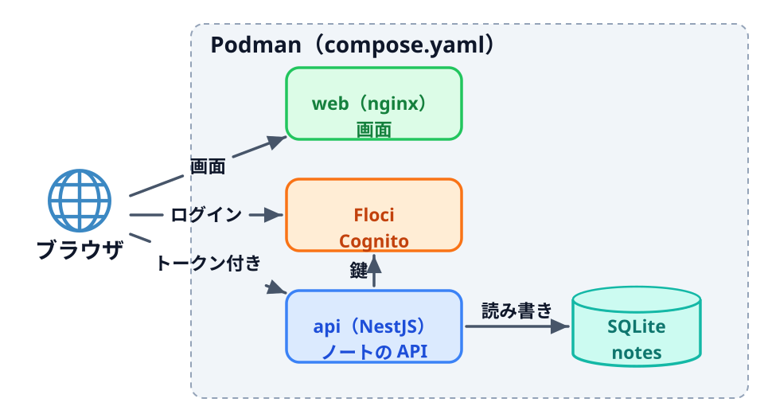

# NestJS と Amazon Cognito で認証と認可

ノートを作成・一覧・削除する API を NestJS で作り、**Amazon Cognito** のトークンで **認証**（誰からの呼び出しかを確かめる）と **認可**（その人にその操作をさせてよいかを確かめる）を足していくハンズオンです。1 つのプロジェクト（`api/`）を、節ごとに少しずつ育てます。

- **API** — NestJS 12（TypeScript）。ノートの作成（ログインした人だけ）・一覧（誰でも）・削除（作った人だけ）
- **データベース** — Node.js に入っている SQLite（`node:sqlite`）
- **画面** — 一覧・サインアップ・ログインの HTML。nginx で配り、`fetch` で API と Cognito を呼びます
- **Cognito** — エミュレーターの [Floci](https://floci.io/) を使います。API・nginx・Floci を Podman で手元に動かすので、AWS のアカウントは要りません

## このハンズオンで作るもの

### 01. 準備

Node.js 26・VS Code・Podman を入れます。

### 02. Hello World

NestJS のプロジェクトを作って「Hello World!」を返し、API と画面を配る nginx を Podman で動かします。

### 03. 設計する

コードを書く前に、ノートの API・認証・認可を表と図で決めます。

### 04. 実装する

SQLite を用意し、ノートの作成・一覧・削除をコントローラーに直接書きます。一覧の画面も作ります。

### 05. 認証する

Floci のユーザープールにサインアップ・ログインする画面を作り、アクセストークンが無いとノートを作れないようにします。

### 06. 認可する

ノートを消せるのを作った人だけにし、別の人では `403`、作った人では `204` になることを確かめます。

### 07. 整理する

動きを変えずに、データベースのプロバイダー・サービス・認証の middleware の順に、NestJS の標準の形に整えます。

## 進め方

- 02 章で作る NestJS のプロジェクト（`api/`）を、1 つのフォルダで節ごとに育てます。
- ファイルを書き換える手順は、前の節との差分で示します。行頭が `+` の行を足し、`-` の行を消します。新しく作るファイルは、すべての行に `+` が付きます。見出しが「`ファイル` を作成する／変更する」のところは自分で書く手順で、「`ファイル` が作られる／変わる」のところは、直前のコマンドがした変更です。
- 各節のページの最後に、その節を終えたときのディレクトリと、その状態のプロジェクトの ZIP があります。途中の節から始めるときは、ひとつ前の節の ZIP を展開し、中の `README.md` の手順で起動します。

前提:

- macOS / Windows 10・11（PowerShell 7）/ Linux のどれか
- ターミナルの基本的な操作（`cd`・`ls`）ができる
- JavaScript を書いたことがある

## 関連するハンズオン

NestJS のハンズオンは 3 本に分かれていて、どれから始めても進められます。Cognito と Entra ID のハンズオンも関連しています。つながりは [関連するハンズオン](./sections/RELATED.md) にまとめています。

- [NestJS で作る REST API](https://github.com/seekseep/nestjs-rest-api-handson)
- NestJS と Cognito で認証と認可（このハンズオン）
- [NestJS のテスト](https://github.com/seekseep/nestjs-testing-handson)
- [Cognito と Entra ID をローカルで練習する](https://github.com/seekseep/cognito-entra-id-emulation-handson)

## ドキュメントサイト

各節の解説は GitHub Pages で読めます: <https://seekseep.github.io/nestjs-cognito-auth-handson/>

## ライセンス・注意事項

- 学習用リポジトリです
