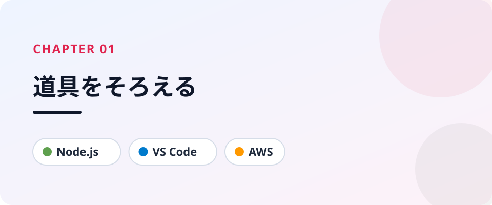

# 道具をそろえる



このハンズオンで使うのは、**Node.js 26**・**Podman**・エディタの **VS Code** です。API と、Amazon Cognito のエミュレーター **Floci** を Podman のコンテナで動かすので、AWS のアカウントは要りません。

## お使いの OS を選ぶ

手順が OS で分かれるところでは、選んだ OS の手順だけを表示します。あとから、ナビゲーションバーの選択欄でも変えられます。

::platform-choice

:::::platform
::::macos
macOS では、ターミナル（「アプリケーション」→「ユーティリティ」→「ターミナル」）で進めます。
::::
::::windows
Windows では、**PowerShell 7** で進めます。Windows 11 か Windows 10（64 ビット）、メモリ 8 GB 以上、ディスクの空き 5 GB 以上を用意してください。

最初から入っている「Windows PowerShell」（5.1）では、`&&` でコマンドをつなげない・`curl` が別のコマンドになっている、などでこのハンズオンのコマンドが動きません。スタートメニューから「Windows PowerShell」を開き、PowerShell 7 を入れます。

```powershell
winget install --id Microsoft.PowerShell --source winget
```

入れたら、スタートメニューから **PowerShell 7**（`pwsh`）を開きます。以降のコマンドは、すべて PowerShell 7 で実行します。

```powershell
$PSVersionTable.PSVersion
```

`7.` から始まる番号が出れば大丈夫です。
::::
::::linux
Linux では、ふだんのターミナルで進めます。
::::
:::::

## Node.js 26 を入れる

NestJS は Node.js の上で動きます。[Node.js のダウンロードのページ](https://nodejs.org/ja/download) でバージョンに **v26（LTS）** を選び、公式のインストーラーで入れます。

:::::platform
::::macos
macOS 用のインストーラー（`.pkg`）をダウンロードして開き、画面の案内に従って進めます。
::::
::::windows
Windows 用のインストーラー（`.msi`）をダウンロードして開き、画面の案内に従って進めます。
::::
::::linux
ダウンロードのページで OS に **Linux** を選び、表示されたコマンドを実行します。
::::
:::::

入れたら、ターミナル（Windows では PowerShell 7）を開き直して確かめます。

```bash
node -v
npm -v
```

```text
v26.13.1
11.12.1
```

`v26.` から始まっていれば大丈夫です（細かい番号は入れた日によって違います）。npm は Node.js といっしょに入るパッケージマネージャーです。

## VS Code を入れる

エディタには [Visual Studio Code](https://code.visualstudio.com/)（VS Code）を使います。[ダウンロードのページ](https://code.visualstudio.com/download) から、お使いの OS のものを入れます。

:::::platform
::::macos
`.zip` を開くとできる `Visual Studio Code.app` を「アプリケーション」フォルダに移します。

VS Code を開き、コマンドパレット（Cmd + Shift + P）で **Shell Command: Install 'code' command in PATH** を実行すると、ターミナルから `code .` でフォルダを開けるようになります。
::::
::::windows
ユーザー インストーラー（User Installer）をダウンロードして開き、画面の案内に従って進めます。「PATH への追加」にチェックが入っていれば、PowerShell 7 から `code .` でフォルダを開けます。
::::
::::linux
Ubuntu・Debian なら `.deb` をダウンロードして入れます。

```bash
sudo apt install ./<ダウンロードしたファイル>.deb
```
::::
:::::

ターミナルを開き直して確かめます。

```bash
code --version
```

バージョンの番号が出れば、ターミナルから `code` を使えます。VS Code の中では、`` Ctrl + ` ``（バッククォート）でターミナルが開きます。

## Podman を入れる

Podman は、コンテナを動かす道具です。02 章で API を、03 章から Cognito のエミュレーター Floci も、コンテナで動かします。あわせて、`podman compose` が使う **docker-compose** も入れます。

:::::platform
::::macos
[Homebrew](https://brew.sh/ja/) で入れます。

```bash
brew install podman docker-compose
```

macOS ではコンテナが Linux の仮想マシンの中で動きます。仮想マシンを作って起動します（`init` は最初の 1 回だけ。パソコンを再起動したら `start` をし直します）。

```bash
podman machine init
podman machine start
```
::::
::::windows
```powershell
winget install --id RedHat.Podman --source winget
winget install --id Docker.DockerCompose --source winget
```

PowerShell 7 を開き直し、コンテナを動かす仮想マシンを作って起動します（`init` は最初の 1 回だけ。パソコンを再起動したら `start` をし直します）。仮想マシンには WSL2 を使います。WSL2 が入っていなければ `init` が入れるか聞いてくるので、案内に従ってください。

```powershell
podman machine init
podman machine start
```
::::
::::linux
Ubuntu の例です。Linux ではコンテナがそのまま動くので、仮想マシンは要りません。docker-compose が Podman とやり取りできるように、Podman のソケットを有効にします。

```bash
sudo apt-get update
sudo apt-get install -y podman docker-compose-v2
systemctl --user enable --now podman.socket
```
::::
:::::

確かめます。

```bash
podman --version
podman compose version
```

```text
podman version 6.2.0
Docker Compose version 5.8.0
```

`podman compose version` が `Docker Compose version` を表示すれば大丈夫です（細かい番号は入れた日によって違います）。

## 参考にした公式ドキュメント

この節は、次の公式ドキュメントをもとに書いています。

- [Node.js: ダウンロード](https://nodejs.org/ja/download) … Node.js の入れ方
- [Microsoft Learn: Windows への PowerShell のインストール](https://learn.microsoft.com/ja-jp/powershell/scripting/install/installing-powershell-on-windows) … winget で PowerShell 7 を入れる方法
- [Visual Studio Code: Setup Overview](https://code.visualstudio.com/docs/setup/setup-overview) … OS ごとの入れ方
- [Podman: Installation](https://podman.io/docs/installation) … OS ごとの Podman の入れ方と `podman machine`
- [Podman: podman-compose](https://docs.podman.io/en/latest/markdown/podman-compose.1.html) … `podman compose` が docker-compose に処理を渡すこと
