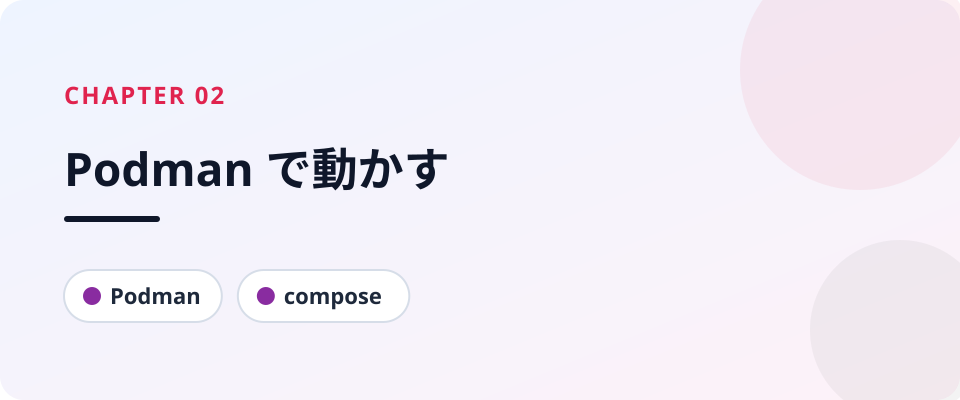

# Podman で動かす



前の節の API を、Podman のコンテナで動かします。03 章からは Cognito のエミュレーターも同じ方法で動かし、2 つをまとめて起動します。

## イメージの作り方を書く

コンテナのもとになる **イメージ** の作り方を書きます。

::diff{file="api/Dockerfile"}

- `npm ci` … `package-lock.json` のとおりにライブラリを入れます
- `npm run build` … TypeScript を `dist/` の JavaScript にします。コンテナでは `node dist/main.js` で動かします

手元の `node_modules`・`dist` と、03 章で作る `.env` はイメージに入れません。

::diff{file="api/.dockerignore"}

## 起動の仕方を書く

`compose.yaml` に、どのコンテナをどう起動するかを書きます。

::diff{file="api/compose.yaml"}

`127.0.0.1:3000:3000` は、自分のパソコンのポート 3000 を、コンテナのポート 3000 につなぐという意味です。

## 動かす

`api/` で起動します。前の節の `npm run start:dev` を動かしていたら、先に止めておきます。

```bash
podman compose up -d --build --wait
```

```text
 Container api-api-1  Started
```

`--build` はイメージを作り直す指定です。**このあとの節でもコードを変えたら、このコマンドで作り直して起動し直します。**

```bash
curl http://localhost:3000/
```

```text
Hello World!
```

止めるときは `podman compose down` です。

## 参考にした公式ドキュメント

この節は、次の公式ドキュメントをもとに書いています。

- [Podman: podman-compose](https://docs.podman.io/en/latest/markdown/podman-compose.1.html) … `podman compose` が docker-compose に処理を渡すこと
- [Docker: Dockerfile reference](https://docs.docker.com/reference/dockerfile/) … `FROM`・`WORKDIR`・`COPY`・`RUN`・`CMD`
- [Docker: Compose file reference](https://docs.docker.com/reference/compose-file/services/) … `build`・`ports`
- [NestJS: First steps](https://docs.nestjs.com/first-steps) … `npm run build` と `dist/main`

## この節を終えたときのディレクトリ

::tree

:::download
[この節を終えた状態をダウンロード](./project.zip)
:::

:::faq

### API のコンテナが動かない

`api/` で、動いているコンテナと、API のログ（エラーの中身）を確かめます。

```bash
podman compose ps
podman compose logs api
```

### `podman compose up` が `Cannot connect to Podman` で失敗する

macOS・Windows では、`podman machine start` で仮想マシンを起動してから実行してください。

:::
