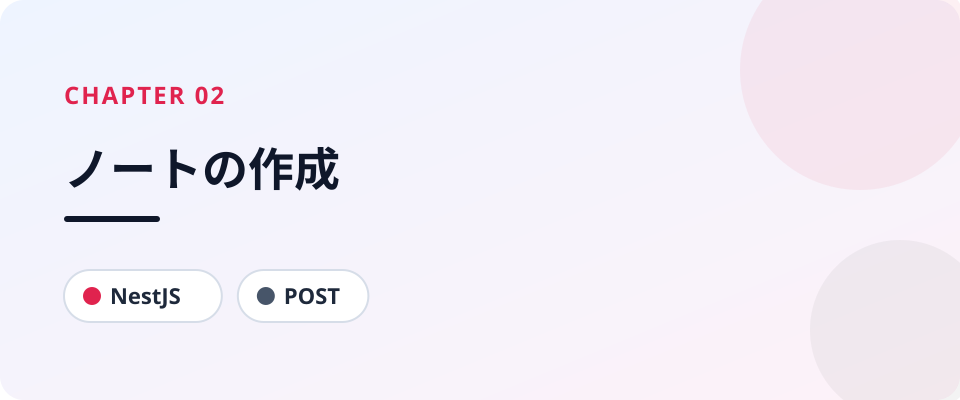

# ノートの作成



`POST /notes` で、ノートを作れるようにします。ノートはデータベースを使わず、メモリ上の配列に持ちます（API を起動し直すと消えます）。

## サービスを作る

ノートを持ち、足す処理を **サービス** に書きます。

::diff{file="api/src/notes/notes.service.ts"}

`randomUUID()` で、ノートごとに重ならない `id` を付けます。

## コントローラーを作る

URL とメソッドを、サービスの処理に結び付けるのが **コントローラー** です。

::diff{file="api/src/notes/notes.controller.ts"}

- `@Controller('notes')` と `@Post()` で、`POST /notes` をこのメソッドに結び付けます
- `@Body()` で、送られてきた JSON を受け取ります
- コンストラクターの引数に `NotesService` を書くと、NestJS が渡してくれます

## モジュールに登録する

::diff{file="api/src/app.module.ts"}

## 動かす

```bash
podman compose up -d --build --wait
```

```bash
curl -X POST http://localhost:3000/notes -H "content-type: application/json" -d '{"text":"buy milk"}'
```

```json
{"id":"a493a29e-4e50-4479-b426-69520520d8a0","text":"buy milk"}
```

## 参考にした公式ドキュメント

この節は、次の公式ドキュメントをもとに書いています。

- [NestJS: Controllers](https://docs.nestjs.com/controllers) … `@Controller()`・`@Post()`・`@Body()`
- [NestJS: Providers](https://docs.nestjs.com/providers) … `@Injectable()` のサービスと、コンストラクターで受け取る仕組み
- [Node.js: crypto.randomUUID()](https://nodejs.org/api/crypto.html#cryptorandomuuidoptions) … ノートの `id`

## この節を終えたときのディレクトリ

::tree

:::download
[この節を終えた状態をダウンロード](./project.zip)
:::
