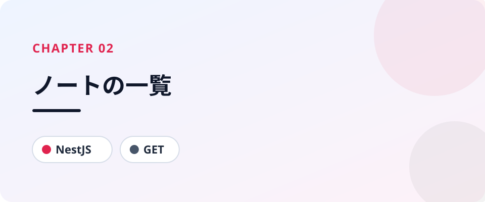

# ノートの一覧



`GET /notes` で、ノートの一覧を返します。

::diff{file="api/src/notes/notes.service.ts"}

::diff{file="api/src/notes/notes.controller.ts"}

## 動かす

```bash
podman compose up -d --build --wait
```

起動し直すとノートは消えるので、作ってから一覧を見ます。

```bash
curl -X POST http://localhost:3000/notes -H "content-type: application/json" -d '{"text":"buy milk"}'
curl http://localhost:3000/notes
```

```json
[{"id":"a493a29e-4e50-4479-b426-69520520d8a0","text":"buy milk"}]
```

## 参考にした公式ドキュメント

この節は、次の公式ドキュメントをもとに書いています。

- [NestJS: Controllers](https://docs.nestjs.com/controllers) … `@Get()`

## この節を終えたときのディレクトリ

::tree

:::download
[この節を終えた状態をダウンロード](./project.zip)
:::
