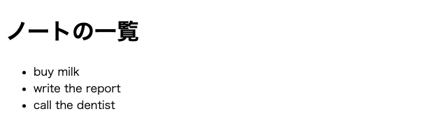

# ノートの一覧


`GET /notes` で、ノートの一覧を返します。あわせて、一覧を見る画面を作ります。一覧は誰でも見られます。

## 一覧を返す

::diff{file="api/src/notes/notes.service.ts"}

::diff{file="api/src/notes/notes.controller.ts"}

## 一覧の画面を作る

`public/` の中のファイルを、そのまま配るようにします。

::diff{file="api/src/main.ts"}

`GET /notes` を呼んで、ノートを並べる画面です。

::diff{file="api/public/notes.html"}

`public/notes.html` は <http://localhost:3000/notes.html> で開けます。`GET /`（Hello World）とはぶつかりません。

## 動かす

```bash
podman compose up -d --build --wait
```

起動し直すとノートは消えるので、作ってから一覧を見ます。

```bash
curl -X POST http://localhost:3000/notes -H "content-type: application/json" -d '{"text":"buy milk"}'
curl http://localhost:3000/notes
```

```json
[{"id":"a493a29e-4e50-4479-b426-69520520d8a0","text":"buy milk"}]
```

<http://localhost:3000/notes.html> を開くと、作ったノートが並んでいます。**このあとの節でも、作成や削除をしたら、この画面を読み込み直して結果を確かめます。**



## 参考にした公式ドキュメント

この節は、次の公式ドキュメントをもとに書いています。

- [NestJS: Controllers](https://docs.nestjs.com/controllers) … `@Get()`
- [NestJS: Model-View-Controller](https://docs.nestjs.com/http/mvc) … `useStaticAssets()` で `public/` を配る

## この節を終えたときのディレクトリ

::tree

:::download
[この節を終えた状態をダウンロード](./project.zip)
:::
