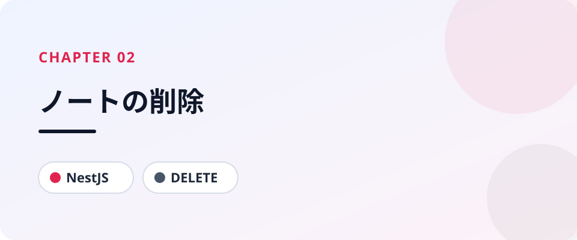

# ノートの削除



`DELETE /notes/:id` で、ノートを消します。

::diff{file="api/src/notes/notes.service.ts"}

指定した `id` のノートが無ければ、`NotFoundException` を投げます。NestJS が `404` の応答にします。

::diff{file="api/src/notes/notes.controller.ts"}

- `@Delete(':id')` と `@Param('id')` で、URL の `:id` の部分を受け取ります
- `@HttpCode(204)` … 消したあとに返すものは無いので、`204 No Content` にします

## 動かす

```bash
podman compose up -d --build --wait
curl -X POST http://localhost:3000/notes -H "content-type: application/json" -d '{"text":"buy milk"}'
```

返ってきた `id` を指定して消します。

```bash
curl -i -X DELETE http://localhost:3000/notes/<id>
```

```text
HTTP/1.1 204 No Content
```

`curl http://localhost:3000/notes` が `[]` になっていれば、消えています。

## 参考にした公式ドキュメント

この節は、次の公式ドキュメントをもとに書いています。

- [NestJS: Controllers](https://docs.nestjs.com/controllers) … `@Delete()`・`@Param()`・`@HttpCode()`
- [NestJS: Exception filters](https://docs.nestjs.com/exception-filters) … `NotFoundException` が `404` になること

## この節を終えたときのディレクトリ

::tree

:::download
[この節を終えた状態をダウンロード](./project.zip)
:::
