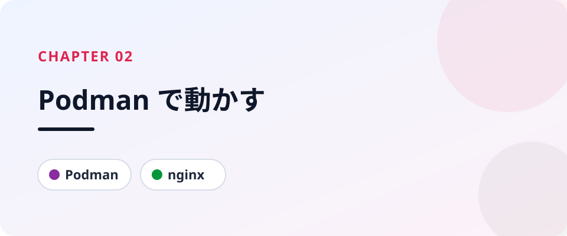
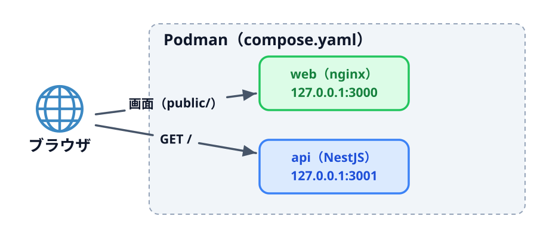

# Podman で動かす



前の節の API と、画面を配る **nginx** を、Podman のコンテナで動かします。05 章からは Cognito のエミュレーターも同じ方法で動かし、まとめて起動します。



画面（3000 番）と API（3001 番）はポートが違うので、ブラウザから見ると別のサイトです。画面から API を呼べるように、API で **CORS** を許します。

## イメージの作り方を書く

API のコンテナのもとになる **イメージ** の作り方を書きます。

::diff{file="api/Dockerfile"}

- `npm ci` … `package-lock.json` のとおりにライブラリを入れます
- `npm run build` … TypeScript を `dist/` の JavaScript にします。コンテナでは `node dist/main.js` で動かします

手元の `node_modules`・`dist` はイメージに入れません。

::diff{file="api/.dockerignore"}

## 起動の仕方を書く

`compose.yaml` に、どのコンテナをどう起動するかを書きます。

::diff{file="api/compose.yaml"}

- `api` … このフォルダの `Dockerfile` から作った API です。`127.0.0.1:3001:3000` は、自分のパソコンの 3001 番を、コンテナの 3000 番につなぐという意味です
- `web` … `public/` の画面を配るだけの nginx です。`./public` を読み取り専用（`ro`）でコンテナに渡します

## 画面から API を呼べるようにする

::diff{file="api/src/main.ts"}

- `enableCors({ origin: 'http://localhost:3000' })` … `http://localhost:3000` の画面からの呼び出しだけを許します

## 画面を作る

画面は、HTML と、同じ名前の `.js` の組にします。画面どうしで使う部品は `public/lib/` に、見た目は `style.css` に置きます。

::diff{file="api/public/lib/api.js"}

::diff{file="api/public/index.html"}

::diff{file="api/public/index.js"}

::diff{file="api/public/style.css"}

## 動作確認する

前の節の `npm run start:dev` を動かしていたら、Ctrl + C で止めておきます。`api/` で起動します。

```bash
podman compose up -d --build --wait
```

```text
 Container api-api-1  Healthy
 Container api-web-1  Healthy
```

ブラウザで <http://localhost:3000> を開き、「API の返事: Hello World!」と出れば大丈夫です。API は 3001 番で直接呼べます。

```bash
curl -i http://localhost:3001/
```

1 行目が `HTTP/1.1 200 OK` で、最後の行が `Hello World!` になれば大丈夫です。

`--build` はイメージを作り直す指定です。**このあとの節でもコードを変えたら、このコマンドで作り直して起動し直します。** 止めるときは `podman compose down` です。

## 参考にした公式ドキュメント

この節は、次の公式ドキュメントをもとに書いています。

- [Podman: podman-compose](https://docs.podman.io/en/latest/markdown/podman-compose.1.html) … `podman compose` が docker-compose に処理を渡すこと
- [Docker: Dockerfile reference](https://docs.docker.com/reference/dockerfile/) … `FROM`・`WORKDIR`・`COPY`・`RUN`・`CMD`
- [Docker: Compose file reference](https://docs.docker.com/reference/compose-file/services/) … `build`・`image`・`ports`・`volumes`
- [Docker Hub: nginx](https://hub.docker.com/_/nginx) … `/usr/share/nginx/html` のファイルを配る
- [NestJS: CORS](https://docs.nestjs.com/security/cors) … `enableCors()` と `origin`

## この節を終えたときのディレクトリ

::tree

:::download
[この節を終えた状態をダウンロード](./project.zip)
:::

:::faq

### `podman compose up` が `Cannot connect to Podman` で失敗する

Podman の仮想マシンが止まっています。`podman machine start` で起動してから、もう一度実行してください（Linux では要りません）。

### `address already in use` で起動できない

3000 番か 3001 番を、ほかのプログラムが使っています。前の節の `npm run start:dev` が残っていないか確かめ、Ctrl + C で止めてください。

### 画面に「API の返事」が出ない

API が起動していないか、`src/main.ts` の `enableCors()` が足りていません。`podman compose up -d --build --wait` で作り直して起動し、読み込み直してください。

:::
