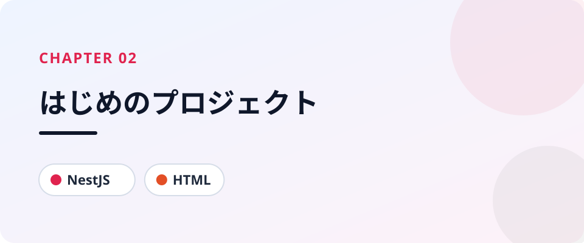

# はじめのプロジェクト



このハンズオンは、**メモの REST API** ができあがった状態から始めます。まず、そのプロジェクトをダウンロードして動かし、どのファイルが何をしているかを見ておきます。

:::download
[はじめのプロジェクトをダウンロード](./project.zip)
:::

- **REST API** … メモの一覧・取得・作成・更新・削除。メモはメモリ上に持つので、API を起動し直すと消えます
- **画面** … メモの一覧・追加・削除ができる HTML 1 枚。API と同じ NestJS が配ります

いまは、誰でもすべてのメモを読み書きできます。ここに、サインイン（03 章）・認証（04 章）・認可（05 章）を足していきます。

## 動かす

ZIP を展開し、中の `api/` に移って、ライブラリを入れてから起動します。

```bash
cd api
npm install
npm run start:dev
```

```text
[Nest] 12345  - ... LOG [NestApplication] Nest application successfully started
```

`start:dev` は、ファイルを保存するたびに起動し直すモードです。止めるときは `Ctrl+C` を押します。

ブラウザで <http://localhost:3000> を開き、メモを追加したり削除したりしてみてください。

curl でも呼べます。API を動かしたまま、ターミナルをもう 1 つ開いて実行します。

```bash
curl -X POST http://localhost:3000/notes -H "content-type: application/json" -d '{"title":"shopping","body":"milk"}'
curl http://localhost:3000/notes
```

```json
[{"id":"0b6e…","title":"shopping","body":"milk","createdAt":"2026-…","updatedAt":"2026-…"}]
```

## API の一覧

| メソッドとパス | すること | 成功したとき |
|---|---|---|
| `GET /notes` | メモの一覧 | `200` |
| `GET /notes/:id` | メモを 1 件 | `200`（無ければ `404`） |
| `POST /notes` | メモを作る（`title` は必須、`body` は省略できる） | `201` |
| `PATCH /notes/:id` | メモを書き換える（送った項目だけ） | `200` |
| `DELETE /notes/:id` | メモを消す | `204` |

入力が決まりに合わないときと、`:id` が UUID の形でないときは `400` になります。

## ファイルの役割

`nest new api` で作ったプロジェクトに、メモの API と画面を足したものです。

| ファイル | 役割 |
|---|---|
| `src/main.ts` | 起動するところ。`public/` を配る設定（`useStaticAssets`）と、入力チェックの設定（`StandardSchemaValidationPipe`）をして、ポート 3000 で待ち受ける |
| `src/app.module.ts` | アプリ全体のモジュール。`NotesModule` を読み込む |
| `src/notes/notes.controller.ts` | URL とメソッド（`@Get()`・`@Post()` など）を、サービスの処理に結び付ける。`@Body({ schema })` で入力を、`ParseUUIDPipe` で `:id` を確かめる |
| `src/notes/notes.service.ts` | メモを配列に持ち、探す・足す・書き換える・消す |
| `src/notes/entities/note.entity.ts` | メモ 1 件の形（`id`・`title`・`body`・日時） |
| `src/notes/dto/*.dto.ts` | 作る・書き換えるときに受け取る値の決まり（Zod のスキーマ） |
| `public/index.html` | 画面。`fetch` で `/notes` を呼ぶ |

画面と API が同じ場所（`http://localhost:3000`）にあるので、画面からは `fetch('/notes')` のようにパスだけで呼べます。`nest new` が作る `AppController`（`GET /`）は、画面とぶつかるので消しています。

## 参考にした公式ドキュメント

この節は、次の公式ドキュメントをもとに書いています。

- [NestJS: First steps](https://docs.nestjs.com/first-steps) … `nest new` が作るファイルと `npm run start:dev`
- [NestJS: Controllers](https://docs.nestjs.com/controllers) … `@Controller()`・`@Get()`・`@Post()`・`@HttpCode()`
- [NestJS: Validation](https://docs.nestjs.com/application/validation) … Zod のスキーマと `StandardSchemaValidationPipe`・`@Body({ schema })`
- [NestJS: Pipes](https://docs.nestjs.com/pipes) … `ParseUUIDPipe`
- [NestJS: Model-View-Controller](https://docs.nestjs.com/http/mvc) … `useStaticAssets()` で `public/` を配る

## この節を終えたときのディレクトリ

::tree

:::download
[はじめのプロジェクトをダウンロード](./project.zip)
:::

:::faq

### `npm run start:dev` で `EADDRINUSE` と出る

ほかのプログラムがポート 3000 を使っています。そのプログラムを止めてから起動してください。

:::
