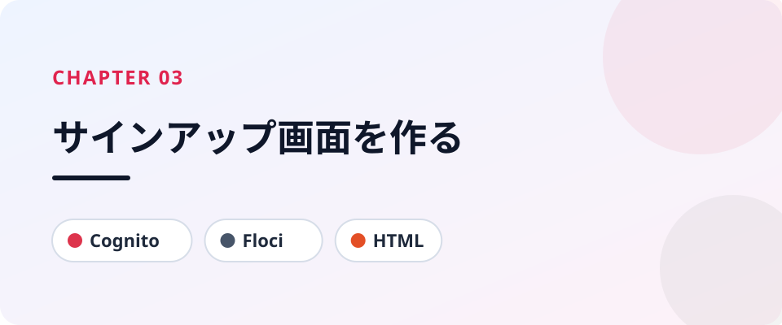

# サインアップ画面を作る



いまは誰でもノートを作れます。この章では、**ログインした人だけがノートを作れる** ようにします（**認証**）。ログインの仕組みには **Amazon Cognito** を使います。本物の代わりに、手元で動くエミュレーター **[Floci](https://floci.io/)** を Podman で動かします。

この節では、Floci を起動してユーザープールを作り、ユーザーを登録する **サインアップ画面** を作ります。

```text
サインアップ画面 ──メールアドレスとパスワード──▶ Cognito（Floci: http://localhost:4566）
                ◀──── 確認コード（メール）────┘
```

| 用語 | 意味 |
|---|---|
| **ユーザープール** | ユーザー（メールアドレスとパスワード）を入れておく場所。サインアップやログインを引き受ける |
| **アプリケーションクライアント** | ユーザープールを使うアプリの登録。画面はこの ID を付けて Cognito を呼ぶ |

## Floci を起動する

`compose.yaml` に Floci を足します。

::diff{file="api/compose.yaml"}

- `env_file` … 次に作るスクリプトが書く `.env`（ユーザープール ID とクライアント ID）を、API のコンテナに渡します
- `FLOCI_BASE_URL` … 発行するトークンの発行元を `http://floci:4566` にします。compose の中では、ほかのコンテナに **サービス名**（`floci`）で届くので、API のコンテナから確かめられる名前にしておきます
- `FLOCI_SECURITY_EXTRA_CORS_ALLOWED_ORIGINS` … 画面（`http://localhost:3000`）から Floci を直接呼ぶので、その呼び出しを許します

## ユーザープールを作る

Cognito の API を呼んで、ユーザープールとアプリケーションクライアントを作るスクリプトです。

::diff{file="api/scripts/setup-cognito.mjs"}

- `AutoVerifiedAttributes: ['email']` … サインアップしたら、メールで確認コードを送ります
- `GenerateSecret: false` … ブラウザで動くコードは誰でも中身を見られるので、クライアントシークレットは持たせません
- `ALLOW_USER_PASSWORD_AUTH` … メールアドレスとパスワードでのログインを許します（次の節）

## サインアップ画面を作る

画面は、ノートの一覧の画面と同じく `public/` に置きます。画面はクライアント ID を知る必要があるので、`GET /config` で渡します。

::diff{file="api/src/app.controller.ts"}

Cognito の API を呼ぶ関数を、サインアップ画面とログイン画面で使えるように 1 つのファイルにします。

::diff{file="api/public/cognito.js"}

どの操作かを `x-amz-target` ヘッダーで伝えます。サインアップやログインの API は、クライアント ID だけで呼べます。

::diff{file="api/public/signup.html"}

- `SignUp` … メールアドレスとパスワードで登録します。Cognito が確認コードをメールで送ります
- `ConfirmSignUp` … 届いた確認コードを送ると、登録が確定します

## 動かす

`api/` で、Floci と API を起動し、ユーザープールを作ってから、`.env` を読ませるためにもう一度起動します。

```bash
podman compose up -d --build --wait
node scripts/setup-cognito.mjs
podman compose up -d --wait
```

```text
ユーザープール us-east-1_9e0314077 とクライアント 7d4b268ac444443da68e9a0328 を作り、.env に書きました
```

<http://localhost:3000/signup.html> を開き、`alice@example.com` とパスワード `Passw0rd!` で **サインアップ** を押します。

Floci はメールを本当には送らず、手元にためておきます。<http://localhost:4566/_aws/ses> を開くと、`Your verification code is 273386.` のように確認コードが読めます。これを入れて **確認する** を押し、「サインアップできました」と出れば登録できています。

:::warning
Floci はデータをメモリに持つので、`podman compose down` やパソコンの再起動でユーザープールもユーザーも消えます。そのときは上の 3 つのコマンドからやり直し、サインアップし直してください。
:::

## 参考にした公式ドキュメント

この節は、次の公式ドキュメントをもとに書いています。

- [Floci: Cognito](https://floci.io/floci/services/cognito/) … Floci の Cognito と、CORS の設定
- [Amazon Cognito API: SignUp](https://docs.aws.amazon.com/cognito-user-identity-pools/latest/APIReference/API_SignUp.html) … サインアップ
- [Amazon Cognito API: ConfirmSignUp](https://docs.aws.amazon.com/cognito-user-identity-pools/latest/APIReference/API_ConfirmSignUp.html) … 確認コードでの確定
- [Amazon Cognito: Application-specific settings with app clients](https://docs.aws.amazon.com/cognito/latest/developerguide/user-pool-settings-client-apps.html) … クライアントシークレットを使わないアプリケーションクライアント
- [Docker: Compose file reference](https://docs.docker.com/reference/compose-file/services/) … `env_file` と `healthcheck`

## この節を終えたときのディレクトリ

::tree

:::download
[この節を終えた状態をダウンロード](./project.zip)
:::

ZIP には `.env` は入っていません。展開したら、上の「動かす」のコマンドで作ってください。

:::faq

### サインアップ画面がうまく動かない

`F12` でブラウザの開発者ツールを開きます。**Network** タブで Cognito（`localhost:4566`）へのリクエストと返ってきたエラー（`__type` と `message`）を、**Console** タブで画面のエラーを確かめます。Floci のログは `api/` で `podman compose logs floci` で見られます。

### `Failed to fetch` や `ResourceNotFoundException` と出る

Floci が止まっているか、起動し直してユーザープールが消えています。「動かす」の 3 つのコマンドをやり直してください。

:::
