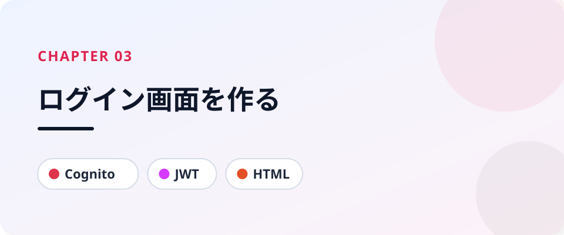

# ログイン画面を作る



前の節で登録したユーザーでログインし、Cognito から **アクセストークン** を受け取る画面を作ります。

```text
ログイン画面 ──メールアドレスとパスワード（InitiateAuth）──▶ Cognito（Floci）
            ◀──────── アクセストークン（JWT）─────────┘
```

::diff{file="api/public/login.html"}

- `InitiateAuth` を `USER_PASSWORD_AUTH` で呼ぶと、メールアドレスとパスワードを確かめて、トークンを返します
- 返ってくるトークンのうち、API を呼ぶときに付けるのは **アクセストークン** です。画面に出して、次の節から curl でコピーして使います

## アクセストークンとは

アクセストークンは **JWT**（JSON Web Token）という形の文字列です。`.` で区切られた 3 つの部分でできています。

```text
eyJhbGciOi...（ヘッダー）.eyJzdWIiOi...（ペイロード）.lT9S1nnH...（署名）
```

ペイロードには、次のような項目が入っています。

| 項目 | 意味 |
|---|---|
| `sub` | ユーザーごとに決まる ID。04 章で「ノートを作った人」に使う |
| `iss` | 発行元（どのユーザープールが発行したか） |
| `client_id` | どのアプリケーションクライアントのために発行したか |
| `token_use` | `access`（アクセストークン） |
| `exp` | 期限。発行から 1 時間 |

中身は誰でも読めます。大事なのは **署名** です。署名は Cognito だけが持つ秘密鍵で作られていて、Cognito が公開している公開鍵で確かめられます。中身を 1 文字でも書き換えると、署名が合わなくなります。

## 動かす

```bash
podman compose up -d --build --wait
```

<http://localhost:3000/login.html> を開き、前の節で登録した `alice@example.com` と `Passw0rd!` で **ログイン** を押します。「ログインできました」と出て、下の欄に `eyJ` で始まるアクセストークンが出れば成功です。

## 参考にした公式ドキュメント

この節は、次の公式ドキュメントをもとに書いています。

- [Amazon Cognito API: InitiateAuth](https://docs.aws.amazon.com/cognito-user-identity-pools/latest/APIReference/API_InitiateAuth.html) … `USER_PASSWORD_AUTH` でのログインと、返ってくる `AuthenticationResult`
- [Amazon Cognito: Understanding the access token](https://docs.aws.amazon.com/cognito/latest/developerguide/amazon-cognito-user-pools-using-the-access-token.html) … アクセストークンに入っている項目

## この節を終えたときのディレクトリ

::tree

:::download
[この節を終えた状態をダウンロード](./project.zip)
:::

:::faq

### `NotAuthorizedException: Incorrect username or password.` と出る

メールアドレスかパスワードが違います。Floci を起動し直したときは、ユーザーも消えているので、サインアップからやり直してください。

:::
