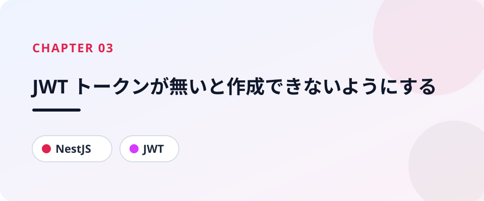

# JWT トークンが無いと作成できないようにする



`POST /notes` で、リクエストに付いたアクセストークンを確かめ、正しいトークンが無ければ `401 Unauthorized` で断ります。誰からの呼び出しかを確かめることを **認証** と呼びます。一覧（`GET /notes`）は、これまでどおり誰でも見られます。

トークンは、リクエストの `Authorization` ヘッダーに付けて送ります。

```text
Authorization: Bearer eyJhbGciOi...
```

## aws-jwt-verify を入れる

トークンの確認には、AWS が公開している **aws-jwt-verify** を使います。

```bash
npm install aws-jwt-verify
```

::diff{file="api/package.json"}

## トークンを確かめる関数を作る

::diff{file="api/src/auth/verify-token.ts"}

- `issuer` … 発行元です。Floci のトークンでは `http://floci:4566/<ユーザープール ID>` になります。ほかのユーザープールが発行したトークンは通りません
- `jwksUri` … 署名を確かめる公開鍵の場所です。発行元の下の `/.well-known/jwks.json` にあります
- `customJwtCheck` … アクセストークンであること（`token_use`）と、自分のアプリケーションクライアント向けであること（`client_id`）を確かめます
- `verifier.verify(token)` … 署名・発行元・期限と `customJwtCheck` を確かめ、正しければトークンの中身を返します。正しくなければ例外を投げるので、`UnauthorizedException`（`401`）にします

本物の Cognito では、発行元が `https://cognito-idp.<リージョン>.amazonaws.com/<ユーザープール ID>` になります。

## 作成のときに確かめる

::diff{file="api/src/notes/notes.controller.ts"}

`@Headers('authorization')` で `Authorization` ヘッダーを受け取り、ノートを作る前に `verifyToken()` で確かめます。

## 動かす

```bash
podman compose up -d --build --wait
```

トークンを付けずに作ろうとすると、`401` になります。

```bash
curl -i -X POST http://localhost:3000/notes -H "content-type: application/json" -d '{"text":"buy milk"}'
```

```text
HTTP/1.1 401 Unauthorized
...
{"message":"Missing bearer token","error":"Unauthorized","statusCode":401}
```

一覧はトークン無しで見られます。

```bash
curl http://localhost:3000/notes
```

```json
[]
```

## 参考にした公式ドキュメント

この節は、次の公式ドキュメントをもとに書いています。

- [aws-jwt-verify（README）](https://github.com/awslabs/aws-jwt-verify) … `JwtVerifier` と、JWKS の取り方を差し替える方法
- [Amazon Cognito: Verifying JSON web tokens](https://docs.aws.amazon.com/cognito/latest/developerguide/amazon-cognito-user-pools-using-tokens-verifying-a-jwt.html) … アクセストークンの検証で確かめること
- [NestJS: Controllers](https://docs.nestjs.com/controllers) … `@Headers()`
- [NestJS: Exception filters](https://docs.nestjs.com/exception-filters) … `UnauthorizedException` が `401` になること

## この節を終えたときのディレクトリ

::tree

:::download
[この節を終えた状態をダウンロード](./project.zip)
:::
