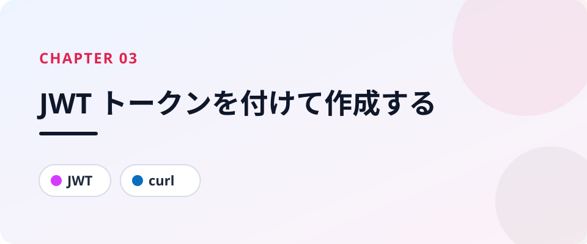

# JWT トークンを付けて作成する



ログイン画面で受け取ったアクセストークンを付けて、ノートを作ります。コードは変えません。

## アクセストークンを用意する

<http://localhost:3000/login.html> で `alice@example.com` にログインし、出てきたアクセストークンをコピーして、ターミナルの変数に入れます。

:::::platform
::::macos-linux
```bash
TOKEN="eyJhbGciOi...（コピーした値）"
```
::::
::::windows
```powershell
$TOKEN = "eyJhbGciOi...（コピーした値）"
```
::::
:::::

## 付けて作成する

```bash
curl -X POST http://localhost:3000/notes -H "content-type: application/json" -H "Authorization: Bearer $TOKEN" -d '{"text":"buy milk"}'
```

```json
{"id":"a9f36853-986b-4c8c-9eab-17439afca9fc","text":"buy milk"}
```

一覧は、トークン無しで見られます。

```bash
curl http://localhost:3000/notes
```

```json
[{"id":"a9f36853-986b-4c8c-9eab-17439afca9fc","text":"buy milk"}]
```

でたらめなトークンを付けると、`401` になります。

```bash
curl -X POST http://localhost:3000/notes -H "content-type: application/json" -H "Authorization: Bearer abc.def.ghi" -d '{"text":"buy milk"}'
```

```json
{"message":"Invalid token","error":"Unauthorized","statusCode":401}
```

## 参考にした公式ドキュメント

この節は、次の公式ドキュメントをもとに書いています。

- [Amazon Cognito: Understanding the access token](https://docs.aws.amazon.com/cognito/latest/developerguide/amazon-cognito-user-pools-using-the-access-token.html) … API を呼ぶときにアクセストークンを付けること

:::faq

### 正しいトークンなのに `Invalid token` と出る

アクセストークンの期限（1 時間）が切れています。ログイン画面でログインし直して、新しいトークンを使ってください。

:::
