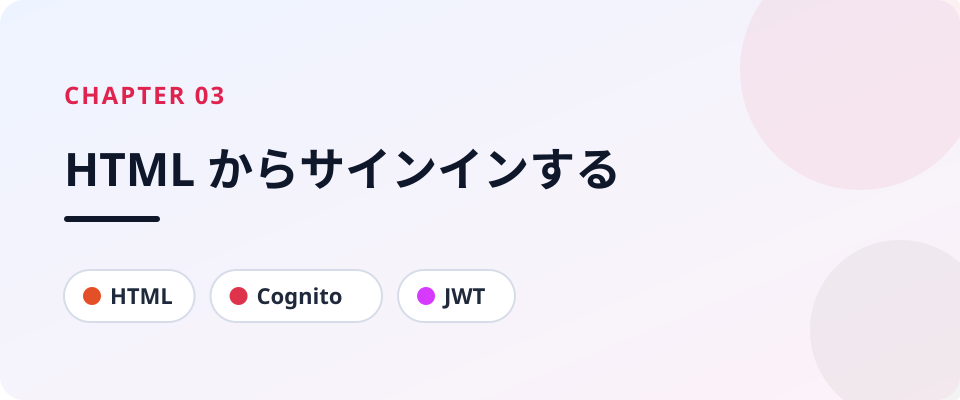

# HTML からサインインする



前の節で作ったユーザーで、画面からサインインできるようにします。サインインできたら、Cognito から受け取った **アクセストークン** を、API を呼ぶときに付けて送ります。

```text
画面を配る   ブラウザ ◀── index.html・/auth/config ── NestJS（http://localhost:3000）
サインイン   ブラウザ ── InitiateAuth ──▶ Cognito（Floci: http://localhost:4566）
API を呼ぶ   ブラウザ ── Authorization: Bearer <アクセストークン> ──▶ NestJS
```

ライブラリは使わず、`fetch` で Cognito の API を直接呼びます。中で何が起きているかが見えるようにするためです。

## 起動するときに .env を読む

前の節のスクリプトが書いた `api/.env` を、Nest CLI の `--env-file` で起動するときに読ませます。読んだ値は `process.env.COGNITO_ENDPOINT` のように使えます。

::diff{file="api/package.json"}

:::danger
`.env` は Git に入れないでください。`api/.gitignore` で無視しています。
:::

## Cognito の入口とクライアント ID を画面に渡す

画面が値を受け取るための API、`GET /auth/config` を作ります。認証にかかわるものは `auth/` にまとめます。

::diff{file="api/src/auth/auth.controller.ts"}

::diff{file="api/src/auth/auth.module.ts"}

::diff{file="api/src/app.module.ts"}

## 画面にサインインを足す

::diff{file="api/public/index.html"}

- **`session`** … サインインできたら、メールアドレスとアクセストークンを `sessionStorage` に置きます。タブを閉じると消えます
- **`decodeJwt`** … アクセストークンの真ん中（ペイロード）を Base64URL から戻して、画面に出します。署名は確かめていません（確かめるのは API の仕事で、04 章で作ります）
- **`api()`** … サインインしていれば、`Authorization: Bearer <アクセストークン>` を付けて API を呼びます
- **`cognito()`** … Cognito の API を 1 つ呼ぶ関数です。サインインの API は、AWS の認証情報なしで、クライアント ID だけで呼べます
- **サインイン** … `InitiateAuth` を `USER_PASSWORD_AUTH` で呼びます。成功すると ID トークン・アクセストークン・リフレッシュトークンが返ります。このハンズオンではアクセストークンだけを使います

## 動かす

`package.json` を変えたので、`Ctrl+C` で止めて起動し直します（`.env` は起動するときにだけ読みます）。

```bash
npm run start:dev
```

<http://localhost:3000> を開き、`alice@example.com` とパスワード `Passw0rd!` で **サインイン** を押します。「`alice@example.com` でサインイン中」になり、「アクセストークンの中身」を開くと、`sub`・`client_id`・`token_use` などが出ています。

ブラウザの開発者ツールの **Network** タブで、次を確かめてください。

- サインインの要求は `localhost:4566`（Floci）に飛んでいて、ヘッダーに `x-amz-target: AWSCognitoIdentityProviderService.InitiateAuth` が付いている。**パスワードは NestJS を通りません**
- サインインしたあとの `notes` への要求に、`Authorization: Bearer eyJ...` が付いている

ただし、API はまだトークンを見ていません。サインアウトしても、curl から呼んでも、これまでどおりメモを読み書きできます。トークンを確かめるのは次の章です。

:::warning
**本番ではこの形にしない**

この画面は、パスワードを自分のフォームで受け取って Cognito に送り、アクセストークンを `sessionStorage` に置いています。トークンの流れを目で追うための練習の形です。`sessionStorage` は、ページに XSS があると読まれてしまう場所です。本番では、サインインの画面ごと Cognito に任せる「マネージドログイン」や、トークンをサーバー側で持つ形を考えてください。
:::

## 参考にした公式ドキュメント

この節は、次の公式ドキュメントをもとに書いています。

- [Amazon Cognito API: InitiateAuth](https://docs.aws.amazon.com/cognito-user-identity-pools/latest/APIReference/API_InitiateAuth.html) … `USER_PASSWORD_AUTH` でのサインインと、返ってくる `AuthenticationResult`
- [Amazon Cognito: Understanding user pool JSON web tokens (JWTs)](https://docs.aws.amazon.com/cognito/latest/developerguide/amazon-cognito-user-pools-using-tokens-with-identity-providers.html) … ID トークン・アクセストークン・リフレッシュトークンの役割
- [NestJS: CLI command reference](https://docs.nestjs.com/cli/usages) … `nest start` の `--env-file`

## この節を終えたときのディレクトリ

::tree

:::download
[この節を終えた状態をダウンロード](./project.zip)
:::

ZIP には `.env` は入っていません。展開したら `npm run floci:up` と `npm run cognito:setup` で作ってください。

:::faq

### 「npm run cognito:setup で api/.env を作って…」と出る

`/auth/config` が値を返していません。`api/.env` があるかを確かめ、API を起動し直してください。

### `Failed to fetch` や `ResourceNotFoundException: Client not found` と出る

Floci が止まっているか、起動し直してデータが消えています。`npm run floci:up` と `npm run cognito:setup` をやり直し、API を起動し直してください。

:::
