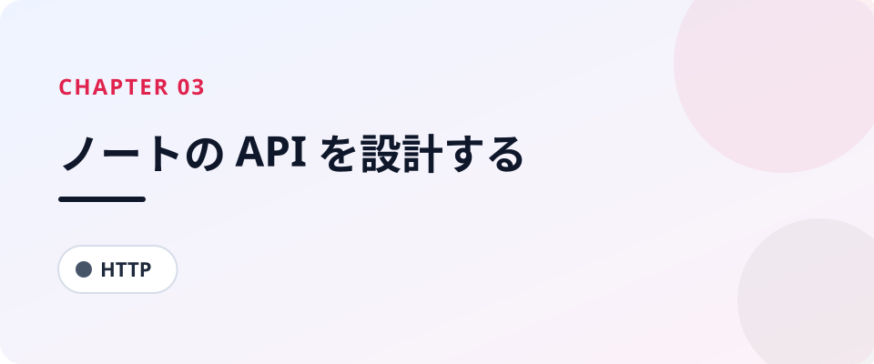
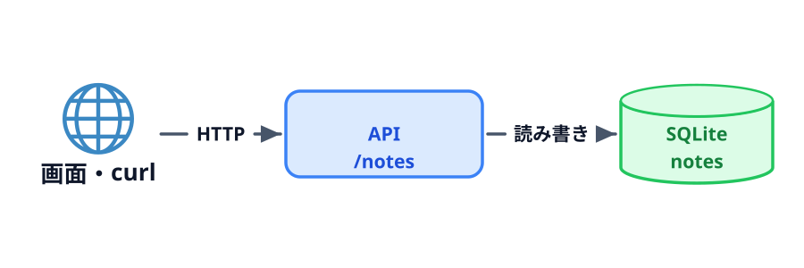

# ノートの API を設計する

この章では、コードを書く前に、作るものを表と図で決めます。この節ではノートの API を、次の節で認証を、その次の節で認可を設計します。04 章からは、この章で決めたとおりに実装します。

## 操作

ノートを作る・一覧を見る・消すの 3 つです。操作の種類は **メソッド** で、対象は **パス** で表します。`/notes` はノート全体、`/notes/{id}` は `id` で決まる 1 件のノートです。

| 操作 | メソッド | パス | 送るもの | 返るもの |
|---|---|---|---|---|
| 作成 | `POST` | `/notes` | `title`・`body`（JSON） | `201` と作ったノート |
| 一覧 | `GET` | `/notes` | なし | `200` とノートの配列 |
| 削除 | `DELETE` | `/notes/{id}` | なし | `204`（本文なし）。無ければ `404` |

## ノートの項目

ノートは SQLite の `notes` テーブルに入れます。項目は、REST API のハンズオンのメモと同じものに、作った人（`ownerId`）を足します。

| 項目 | 型 | 中身 |
|---|---|---|
| `id` | 文字列 | ノートの ID（UUID）。作るときに API が決める |
| `title` | 文字列 | 題名 |
| `body` | 文字列 | 本文。省略すると `''` |
| `createdAt`・`updatedAt` | 文字列 | 作った日時・書き換えた日時（ISO 8601） |
| `ownerId` | 文字列 | 作った人の ID。05 章で認証を足すまでは `null` |

## 参考にした公式ドキュメント

この節は、次の公式ドキュメントをもとに書いています。

- [RFC 9110: HTTP Semantics](https://www.rfc-editor.org/rfc/rfc9110.html#name-method-definitions) … `GET`・`POST`・`DELETE` の意味と、`201`・`204`・`404`
