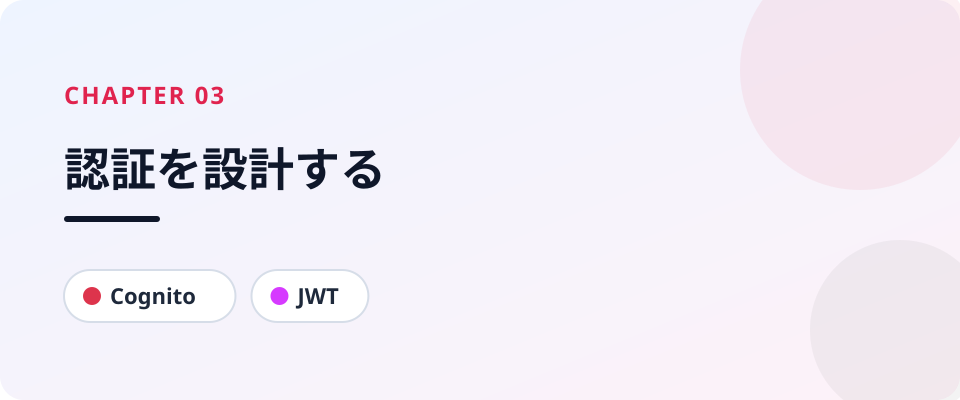
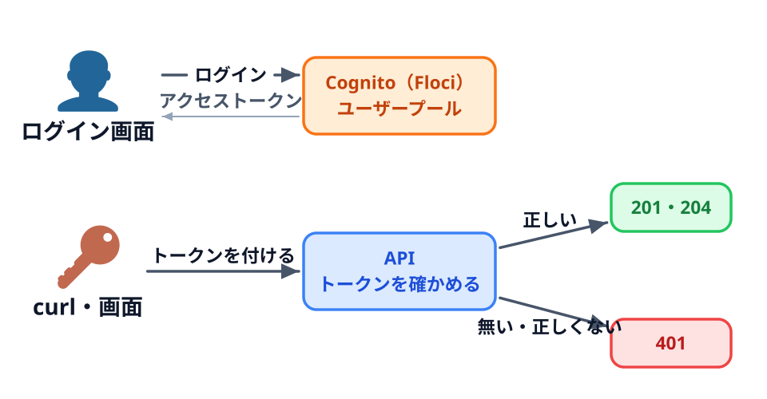

# 認証を設計する

**認証** は、呼び出したのが誰かを確かめることです。ログインの仕組みには **Amazon Cognito** を使います。本物の代わりに、手元で動くエミュレーター **[Floci](https://floci.io/)** を Podman で動かすので、AWS のアカウントは要りません。

| 用語 | 意味 |
|---|---|
| **ユーザープール** | ユーザー（メールアドレスとパスワード）を入れておく場所。サインアップやログインを引き受ける |
| **アプリケーションクライアント** | ユーザープールを使うアプリの登録。画面はこの ID を付けて Cognito を呼ぶ |
| **アクセストークン** | ログインすると受け取る、署名つきの文字列（JWT）。中の `sub` が、ユーザーの ID |

## トークンが要る操作

API を呼ぶときは、`Authorization: Bearer <アクセストークン>` のヘッダーでトークンを付けます。

| 操作 | トークン | トークンが無い・正しくないとき |
|---|---|---|
| 作成（`POST /notes`） | 要る | `401 Unauthorized` |
| 一覧（`GET /notes`） | 要らない | — |
| 削除（`DELETE /notes/{id}`） | 要る | `401 Unauthorized` |

API は、トークンの署名を Cognito が公開している鍵（JWKS）で確かめ、有効期限と、どのアプリのトークンか（`client_id`）も確かめます。作ったノートの `ownerId` には、トークンの `sub` を入れます。

## 参考にした公式ドキュメント

この節は、次の公式ドキュメントをもとに書いています。

- [Amazon Cognito: User pools](https://docs.aws.amazon.com/cognito/latest/developerguide/cognito-user-pools.html) … ユーザープールでできること
- [Amazon Cognito: Understanding user pool JSON web tokens (JWTs)](https://docs.aws.amazon.com/cognito/latest/developerguide/amazon-cognito-user-pools-using-tokens-with-identity-providers.html) … アクセストークンと、その中の `sub`・`client_id`
- [RFC 9110: HTTP Semantics](https://www.rfc-editor.org/rfc/rfc9110.html#name-401-unauthorized) … `401 Unauthorized`
