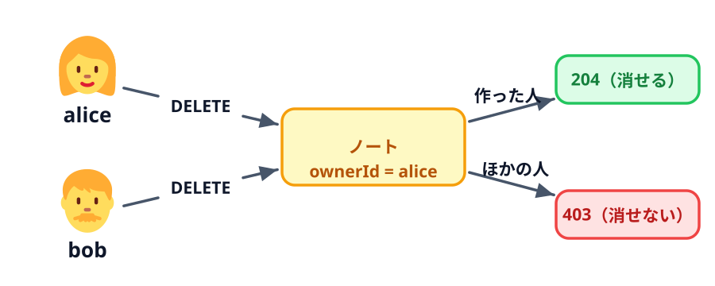

# 認可を設計する

**認可** は、その人にその操作をさせてよいかを確かめることです。このハンズオンでは、**ノートを消せるのは、作った人だけ** にします。

削除のときは、トークンの `sub` と、ノートの `ownerId` を比べます。

| 状況 | 返るもの |
|---|---|
| トークンが無い・正しくない | `401 Unauthorized` |
| ノートが無い | `404 Not Found` |
| 作った人ではない | `403 Forbidden` |
| 作った人 | `204 No Content`（消える） |

`401` は「誰か分からない」、`403` は「誰かは分かったが、させられない」という違いです。06 章では、作った人のほかに、役割（`admin` のグループ）と所属（同じチーム）でも消せるようにします。

## 参考にした公式ドキュメント

この節は、次の公式ドキュメントをもとに書いています。

- [RFC 9110: HTTP Semantics](https://www.rfc-editor.org/rfc/rfc9110.html#name-403-forbidden) … `401 Unauthorized` と `403 Forbidden` の違い
