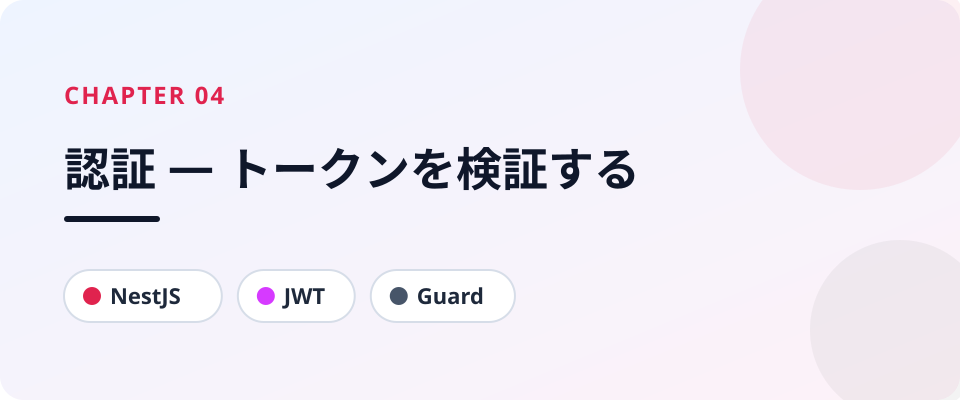

# 認証 — トークンを検証する



画面はアクセストークンを付けて API を呼ぶようになりましたが、API はまだトークンを見ていないので、curl から誰でも呼べます。この節では、API が **アクセストークンを検証して、サインインした人の呼び出しだけを受け付ける** ようにします。これを **認証** と呼び、次の章の **認可** と区別します。

| 言葉 | 確かめること | 章 |
|---|---|---|
| **認証**（Authentication） | 誰からの呼び出しか | この章 |
| **認可**（Authorization） | その人に、その操作をさせてよいか | 05 章 |

## アクセストークンとは

アクセストークンは **JWT**（JSON Web Token）という形の文字列です。`.` で区切られた 3 つの部分でできています。

```text
eyJraWQiOi...（ヘッダー）.eyJzdWIiOi...（ペイロード）.Wd3h1c...（署名）
```

前の節で画面に出した「アクセストークンの中身」が、ペイロードです。主な項目は次のとおりです。

| 項目 | 意味 |
|---|---|
| `sub` | ユーザーごとに決まる ID。05 章で「メモの持ち主」に使う |
| `iss` | 発行元（どのユーザープールが発行したか） |
| `client_id` | どのアプリケーションクライアントのために発行したか |
| `token_use` | `access`（アクセストークン）か `id`（ID トークン）か |
| `exp` | 期限。既定では発行から 1 時間 |

中身は誰でも読めます。大事なのは **署名** です。署名は Cognito だけが持つ秘密鍵で作られていて、Cognito が公開している公開鍵（**JWKS**）で確かめられます。中身を 1 文字でも書き換えると、署名が合わなくなります。API は、署名と中身（発行元・期限など）を確かめてから、呼び出しを受け付けます。

## aws-jwt-verify を入れる

署名と中身の確認には、AWS が公開している **aws-jwt-verify** を使います。公開鍵の取得も引き受けてくれます。

```bash
npm install aws-jwt-verify
```

::diff{file="api/package.json"}

## Guard を作る

NestJS で「このリクエストを通すかどうか」を決める部品を **Guard** と呼びます。Guard の `canActivate()` が `true` を返せば、コントローラーのメソッドが呼ばれます。例外を投げれば、そのままエラーの応答になります。

::diff{file="api/src/auth/auth.guard.ts"}

- `CognitoJwtVerifier.create(...)` … ユーザープール ID・`tokenUse: 'access'`・クライアント ID を渡すと、それに合うトークンだけを正しいとする検証器ができます。ID トークンや、別のアプリケーションクライアントのトークンは通りません
- `requireEnv` … 環境変数が無ければ、起動するときにエラーで止めます
- `this.verifier.verify(token)` … 署名・発行元・期限・`token_use`・`client_id` を確かめ、正しければペイロードを返します。正しくなければ例外を投げるので、`UnauthorizedException`（`401`）にします
- `request.user = ...` … 確かめたペイロードをリクエストに入れておきます。05 章で「誰からの呼び出しか」を知るのに使います

## Guard を掛ける

`@UseGuards(AuthGuard)` をコントローラーに付けると、そのすべてのメソッドに Guard が掛かります。

::diff{file="api/src/notes/notes.controller.ts"}

`/auth/config` には掛けていないので、サインインする前でも呼べます。

## 動かす

`start:dev` が動いていれば、保存したときに起動し直されています。止めていたら `npm run start:dev` で起動します。

### トークン無しでは呼べない

```bash
curl -i http://localhost:3000/notes
```

```text
HTTP/1.1 401 Unauthorized
...
{"message":"Missing bearer token","error":"Unauthorized","statusCode":401}
```

でたらめなトークンを付けても通りません。

```bash
curl http://localhost:3000/notes -H "Authorization: Bearer abc.def.ghi"
```

```json
{"message":"Invalid token","error":"Unauthorized","statusCode":401}
```

### 画面からは呼べる

<http://localhost:3000> でサインインすると、これまでどおりメモを読み書きできます。サインアウトすると、画面の上に `401 Missing bearer token` と出ます。

### 自分のトークンで curl から呼ぶ

ブラウザの開発者ツールの **Network** タブで `notes` への要求を選び、リクエストヘッダーの `Authorization` の値（`Bearer` の後ろ）をコピーします。これを付ければ、curl からも呼べます。05 章・06 章でも、この `TOKEN` を使います。

:::::platform
::::macos-linux
```bash
TOKEN="eyJraWQiOi...（コピーした値）"
curl http://localhost:3000/notes -H "Authorization: Bearer $TOKEN"
```
::::
::::windows
```powershell
$TOKEN = "eyJraWQiOi...（コピーした値）"
curl http://localhost:3000/notes -H "Authorization: Bearer $TOKEN"
```
::::
:::::

アクセストークンの期限は 1 時間です。期限が切れると `Invalid token` になるので、画面でサインインし直してください。

## 参考にした公式ドキュメント

この節は、次の公式ドキュメントをもとに書いています。

- [NestJS: Guards](https://docs.nestjs.com/guards) … Guard の役割と `@UseGuards()`
- [Amazon Cognito: Verifying JSON web tokens](https://docs.aws.amazon.com/cognito/latest/developerguide/amazon-cognito-user-pools-using-tokens-verifying-a-jwt.html) … アクセストークンの検証で確かめること
- [Amazon Cognito: Understanding the access token](https://docs.aws.amazon.com/cognito/latest/developerguide/amazon-cognito-user-pools-using-the-access-token.html) … アクセストークンに入っている項目（`sub`・`client_id`・`token_use` など）
- [aws-jwt-verify（README）](https://github.com/awslabs/aws-jwt-verify) … `CognitoJwtVerifier` の使い方

## この節を終えたときのディレクトリ

::tree

:::download
[この節を終えた状態をダウンロード](./project.zip)
:::

:::faq

### API が `環境変数 COGNITO_USER_POOL_ID がありません` で止まる

`api/.env` が無いか、変数の名前が違います。03-02 の「ID を .env に書く」を確かめてから、起動し直してください。

### 画面で `Invalid token` と出る

アクセストークンの期限（1 時間）が切れていることが多いです。画面でサインアウトして、サインインし直してください。

:::
