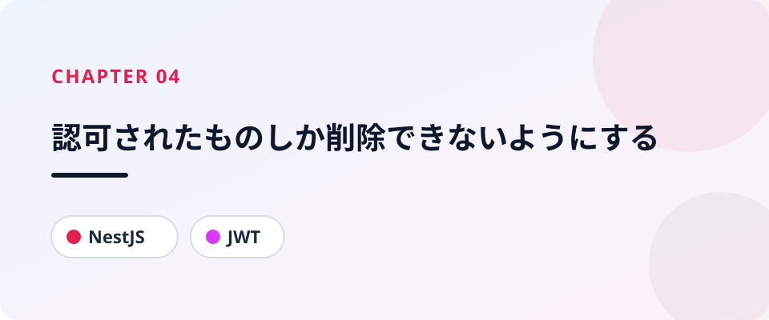

# 認可されたものしか削除できないようにする



いまは、誰でも、どのノートでも消せます。この章では、**ノートを作った人だけが、そのノートを消せる** ようにします。「その人に、その操作をさせてよいか」を確かめることを **認可** と呼びます。

| ステータス | 意味 | この API で返すとき |
|---|---|---|
| `401 Unauthorized` | 誰か分からない（認証の失敗） | トークンが無い・正しくない |
| `403 Forbidden` | 誰かは分かったが、させられない（認可の失敗） | 他の人のノートを消そうとした |

## ノートに作った人を持たせる

ノートに `ownerId` を足し、作った人のアクセストークンの `sub` を入れます。`sub` はユーザーごとに決まり、変わらない ID です。消すときは、`ownerId` と消そうとした人の `sub` が同じかを確かめ、違えば `ForbiddenException`（`403`）にします。

::diff{file="api/src/notes/notes.service.ts"}

## コントローラーからユーザーを渡す

作成と削除の両方でトークンを確かめ、`verifyToken()` が返したトークンの中身から `sub` を渡します。

::diff{file="api/src/notes/notes.controller.ts"}

作った人は、本文（JSON）からではなく、確かめたトークンから決めます。本文から受け取ると、他の人を作った人にしたノートを作れてしまいます。

## 動かす

```bash
podman compose up -d --build --wait
```

API を起動し直したのでノートは消えています。前の節と同じように、alice のトークンで作ります（トークンの期限が切れていたら、ログインし直します）。

```bash
curl -X POST http://localhost:3000/notes -H "content-type: application/json" -H "Authorization: Bearer $TOKEN" -d '{"text":"buy milk"}'
```

```json
{"id":"d161421e-5978-4517-a8a4-72bb9dddcce0","text":"buy milk","ownerId":"67825ac4-21a9-43be-9297-0ec0d2025305"}
```

`ownerId` に、alice の `sub` が入っています。次の節から、この `id` のノートを消してみます。

## 参考にした公式ドキュメント

この節は、次の公式ドキュメントをもとに書いています。

- [Amazon Cognito: Understanding the access token](https://docs.aws.amazon.com/cognito/latest/developerguide/amazon-cognito-user-pools-using-the-access-token.html) … アクセストークンの `sub`
- [NestJS: Exception filters](https://docs.nestjs.com/exception-filters) … `ForbiddenException` が `403` になること

## この節を終えたときのディレクトリ

::tree

:::download
[この節を終えた状態をダウンロード](./project.zip)
:::
