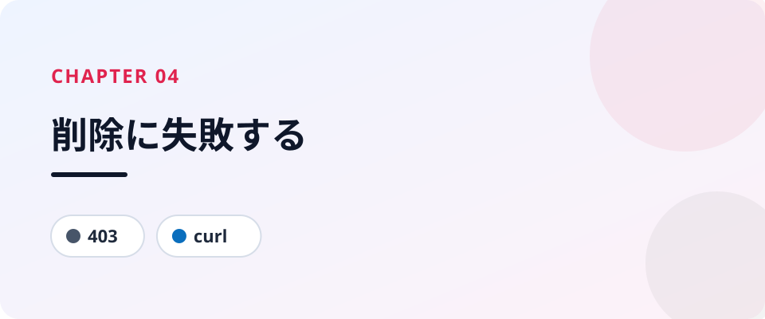

# 削除に失敗する



alice が作ったノートを、別のユーザー（bob）が消そうとすると、`403` で断られることを確かめます。コードは変えません。

## bob を用意する

1. <http://localhost:3000/signup.html> で `bob@example.com` とパスワード `Passw0rd!` でサインアップする。確認コードは <http://localhost:4566/_aws/ses> の一番下にある
2. <http://localhost:3000/login.html> で bob にログインし、アクセストークンをコピーして、変数に入れる

:::::platform
::::macos-linux
```bash
TOKEN="eyJhbGciOi...（bob のアクセストークン）"
```
::::
::::windows
```powershell
$TOKEN = "eyJhbGciOi...（bob のアクセストークン）"
```
::::
:::::

## bob で alice のノートを消す

前の節で作った alice のノートの `id` を指定します（`curl http://localhost:3000/notes` で確かめられます）。

```bash
curl -i -X DELETE http://localhost:3000/notes/<alice のノートの id> -H "Authorization: Bearer $TOKEN"
```

```text
HTTP/1.1 403 Forbidden
...
{"message":"Forbidden","statusCode":403}
```

bob が誰かは分かっています（トークンは正しいので `401` ではない）が、作った人ではないので、消させません。

トークンを付けなければ、誰か分からないので `401` です。

```bash
curl -i -X DELETE http://localhost:3000/notes/<alice のノートの id>
```

```text
HTTP/1.1 401 Unauthorized
```

<http://localhost:3000/notes.html> を読み込み直して、alice のノートが残っていることを確かめます。

## 参考にした公式ドキュメント

この節は、次の公式ドキュメントをもとに書いています。

- [MDN: 403 Forbidden](https://developer.mozilla.org/ja/docs/Web/HTTP/Reference/Status/403) … 認証できても権限が無いときの応答
