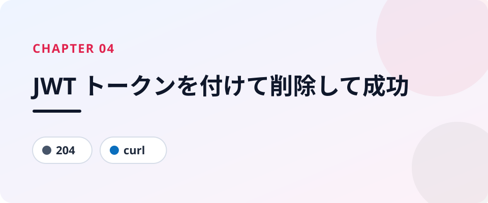

# JWT トークンを付けて削除して成功



ノートを作った alice のトークンなら、消せることを確かめます。コードは変えません。

<http://localhost:3000/login.html> で alice にログインし直し、アクセストークンを変数に入れます。

:::::platform
::::macos-linux
```bash
TOKEN="eyJhbGciOi...（alice のアクセストークン）"
```
::::
::::windows
```powershell
$TOKEN = "eyJhbGciOi...（alice のアクセストークン）"
```
::::
:::::

```bash
curl -i -X DELETE http://localhost:3000/notes/<alice のノートの id> -H "Authorization: Bearer $TOKEN"
```

```text
HTTP/1.1 204 No Content
```

<http://localhost:3000/notes.html> を読み込み直して、ノートが消えていれば成功です。

## 参考にした公式ドキュメント

この節は、次の公式ドキュメントをもとに書いています。

- [MDN: 204 No Content](https://developer.mozilla.org/ja/docs/Web/HTTP/Reference/Status/204) … 成功して、返す本文が無いときの応答
