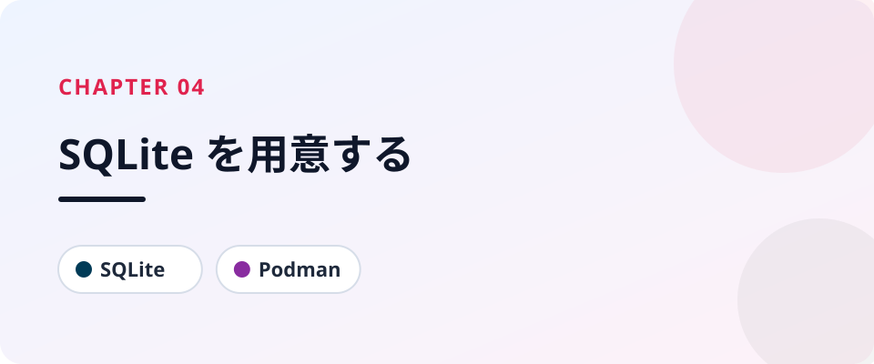

# SQLite を用意する



この章では、03 章で設計したとおりに、ノートの API を実装します。ノートは **SQLite** のデータベースに保存します。API はコンテナで動くので、データベースのファイルは **ボリューム** に置き、コンテナを作り直しても残るようにします。

SQLite は、Node.js に入っている `node:sqlite` で使います。ライブラリを足す必要はありません（Node.js 26 では「Release candidate（安定版の直前）」の段階です）。この節では、データベースを開いて、ノートのテーブルを作るところまでを行います。

## データベースのファイルをボリュームに置く

::diff{file="api/compose.yaml"}

- `DB_PATH: /data/notes.db` … API が開くファイルの場所です（次に作る `src/database.ts` で読みます）
- `db:/data` … `db` という名前のボリュームを、コンテナの `/data` につなぎます。`podman compose down` でコンテナを消しても、ボリュームは残ります

## データベースを開く

::diff{file="api/src/database.ts"}

- `new DatabaseSync(...)` … `DB_PATH` のファイルを開きます。無ければ作ります
- `CREATE TABLE IF NOT EXISTS` … `notes` テーブルが無ければ作ります。列は、03 章で決めたノートの項目です。`ownerId` は `NOT NULL` を付けず、認証を足すまでは `null` を入れます
- `STRICT` … 列の型（`TEXT`）に合わない値を入れようとするとエラーにします

:::notice
Node.js 26 のドキュメントでは、このクラスの名前は `Database` に変わり、`DatabaseSync` は古い名前として残っています。TypeScript の型（`@types/node`）にはまだ `DatabaseSync` しか無いので、このハンズオンでは `DatabaseSync` を使います。
:::

## コントローラーを作る

ノートの API を受け付けるコントローラーを作ります。

```bash
npx nest g controller notes
```

```text
CREATE src/notes/notes.controller.ts (99 bytes)
UPDATE src/app.module.ts (335 bytes)
```

`AppModule` に `NotesController` が登録されます。

::diff{file="api/src/app.module.ts" by="command"}

コントローラーが作られたときに、データベースを開くようにします。この章では、データベースの扱いもコントローラーに直接書きます（07 章で整理します）。

::diff{file="api/src/notes/notes.controller.ts" base="generated"}

## 動作確認する

作り直して起動すると、ボリュームに `notes.db` ができます。コンテナの中で、テーブルができたかを確かめます。

```bash
podman compose up -d --build --wait
podman compose exec api node -e "const { DatabaseSync } = require('node:sqlite'); console.log(new DatabaseSync('/data/notes.db').prepare('SELECT name FROM sqlite_master').all())"
```

```text
[
  [Object: null prototype] { name: 'notes' },
  [Object: null prototype] { name: 'sqlite_autoindex_notes_1' }
]
```

`notes` が出れば大丈夫です（もう 1 つは、`PRIMARY KEY` のために SQLite が作る索引です）。

## 参考にした公式ドキュメント

この節は、次の公式ドキュメントをもとに書いています。

- [Node.js: SQLite](https://nodejs.org/docs/latest-v26.x/api/sqlite.html) … `DatabaseSync`・`exec()`・`prepare()`、安定性（Release candidate）
- [SQLite: STRICT Tables](https://www.sqlite.org/stricttables.html) … `STRICT` の意味
- [NestJS: CLI command reference](https://docs.nestjs.com/cli/usages) … `nest g controller`
- [Docker: Compose file reference](https://docs.docker.com/reference/compose-file/services/) … `environment`・`volumes`
- [Docker: docker compose exec](https://docs.docker.com/reference/cli/docker/compose/exec/) … 動いているコンテナでコマンドを実行する

## この節を終えたときのディレクトリ

::tree

:::download
[この節を終えた状態をダウンロード](./project.zip)
:::
