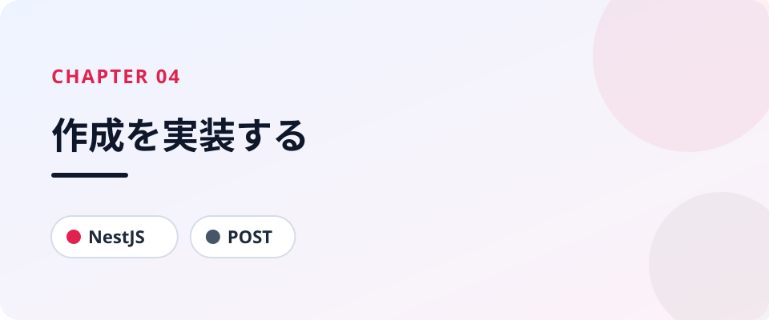

# 作成を実装する



`POST /notes`（作成）を実装します。コントローラーに直接書きます。

## コントローラーに書く

::diff{file="api/src/notes/notes.controller.ts"}

- `type Note` … 03 章で決めたノートの項目です
- `@Body() input` … 届いた本文（JSON）を受け取ります。型は書くときの手助けで、届いた中身を確かめるわけではありません
- `input.body ?? ''` … `body` は省略できるので、無ければ `''` にします
- `ownerId: null` … 作った人は、05 章で認証を足してから入れます
- `@Post()` … `POST /notes` を受け付けます。応答は `201 Created` になります
- `prepare(...).run(note)` … SQL の `:id` などに、`note` の同じ名前の項目を入れて実行します

## 動作確認する

作り直して起動し、ノートを作ります。

```bash
podman compose up -d --build --wait
curl -i -X POST http://localhost:3001/notes -H 'Content-Type: application/json' -d '{"title": "買い物", "body": "牛乳を買う"}'
```

1 行目が `HTTP/1.1 201 Created` で、最後の行に作ったノートが出れば大丈夫です。

```json
{"id":"cf3ba8aa-850c-4fec-bd88-7378c0e88c37","title":"買い物","body":"牛乳を買う","createdAt":"2026-11-21T07:38:27.144Z","updatedAt":"2026-11-21T07:38:27.144Z","ownerId":null}
```

## 参考にした公式ドキュメント

この節は、次の公式ドキュメントをもとに書いています。

- [NestJS: Controllers](https://docs.nestjs.com/controllers) … `@Post()` と `@Body()`
- [Node.js: SQLite](https://nodejs.org/docs/latest-v26.x/api/sqlite.html) … `prepare()` と、名前付きの値（`:id`）での `run()`

## この節を終えたときのディレクトリ

::tree

:::download
[この節を終えた状態をダウンロード](./project.zip)
:::
