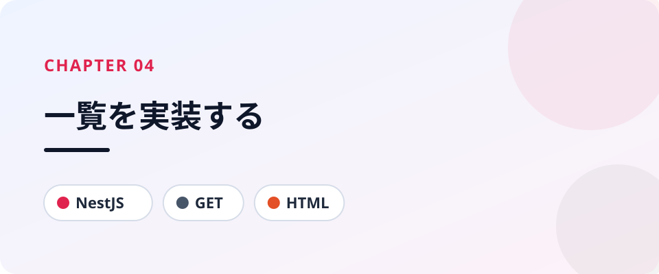

# 一覧を実装する



`GET /notes`（一覧）を実装し、一覧を見る画面を作ります。

## コントローラーに書く

::diff{file="apps/api/src/notes/notes.controller.ts"}

- `@Get()` … `GET /notes` を受け付けます
- `prepare(...).all()` … すべての行を配列で返します。作った順（`createdAt`）に並べます

## 一覧の画面を作る

::diff{file="apps/ui/notes.html"}

::diff{file="apps/ui/notes.js"}

- `item.textContent = ...` … `innerHTML` だと、ノートに書いた HTML が画面で動いてしまうので、文字として入れます

## 動作確認する

```bash
podman compose up -d --build --wait
curl -i http://localhost:3001/notes
```

1 行目が `HTTP/1.1 200 OK` で、最後の行に、これまでに作ったノートの配列が出れば大丈夫です。

ブラウザで <http://localhost:3000/notes.html> を開くと、ノートの題名と本文が並びます。

## 参考にした公式ドキュメント

この節は、次の公式ドキュメントをもとに書いています。

- [NestJS: Controllers](https://docs.nestjs.com/controllers) … `@Get()`
- [Node.js: SQLite](https://nodejs.org/docs/latest-v26.x/api/sqlite.html) … `statement.all()`
- [MDN: Node.textContent](https://developer.mozilla.org/ja/docs/Web/API/Node/textContent) … `innerHTML` との違い

## この節を終えたときのディレクトリ

::tree

:::download
[この節を終えた状態をダウンロード](./project.zip)
:::
