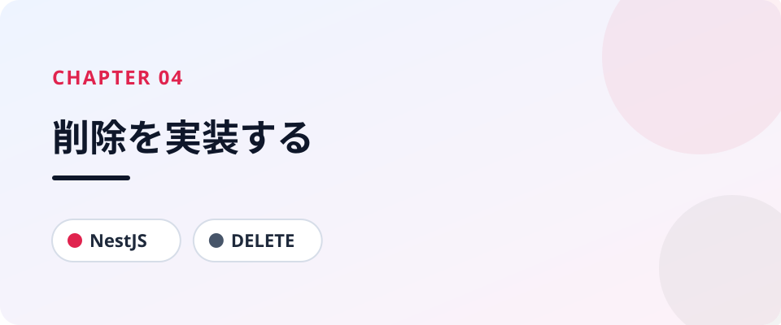

# 削除を実装する



`DELETE /notes/{id}`（削除）を実装します。これで、03 章で設計した 3 つの操作がそろいます。

## コントローラーに書く

::diff{file="apps/api/src/notes/notes.controller.ts"}

- `@HttpCode(204)` … 応答を `204 No Content` にします（何もしなければ `200`）
- `run(id)` が返す `changes` は、消した行の数です。`0` なら、そのノートは無いので `404` にします

## 動作確認する

ID（`cf3ba8aa-850c-4fec-bd88-7378c0e88c37`）は、作ったノートの ID に置き換えます。

```bash
podman compose up -d --build --wait
curl -i -X DELETE http://localhost:3001/notes/cf3ba8aa-850c-4fec-bd88-7378c0e88c37
```

1 行目が `HTTP/1.1 204 No Content` になれば大丈夫です。もう一度同じ ID で送ると `HTTP/1.1 404 Not Found` になります。

## 参考にした公式ドキュメント

この節は、次の公式ドキュメントをもとに書いています。

- [NestJS: Controllers](https://docs.nestjs.com/controllers) … `@Delete()`・`@Param()`・`@HttpCode()`
- [Node.js: SQLite](https://nodejs.org/docs/latest-v26.x/api/sqlite.html) … `run()` が返す `changes`

## この節を終えたときのディレクトリ

::tree

:::download
[この節を終えた状態をダウンロード](./project.zip)
:::
