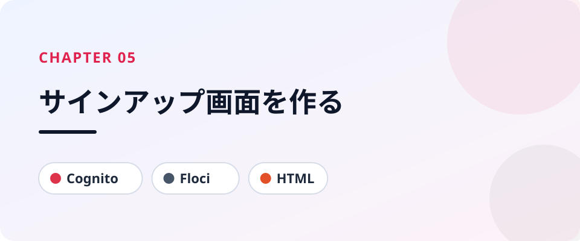
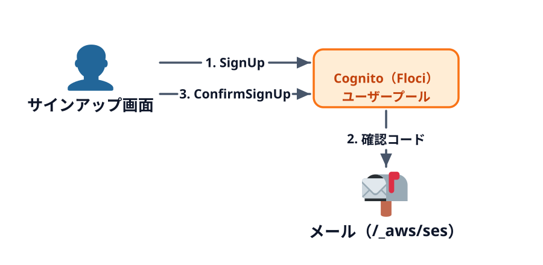

# サインアップ画面を作る



いまは誰でもノートを作れます。この章では、03 章で設計したとおりに、**ログインした人だけがノートを作れる** ようにします（**認証**）。

この節では、Cognito のエミュレーター **Floci** を起動してユーザープールを作り、ユーザーを登録する **サインアップ画面** を作ります。



## Floci を起動する

`compose.yaml` に Floci を足します。

::diff{file="compose.yaml"}

- `env_file` … 次に作るスクリプトが書く `.env`（ユーザープール ID とクライアント ID）を、API のコンテナに渡します
- `FLOCI_BASE_URL` … 発行するトークンの発行元を `http://floci:4566` にします。compose の中では、ほかのコンテナに **サービス名**（`floci`）で届くので、API のコンテナから確かめられる名前にしておきます
- `FLOCI_SECURITY_EXTRA_CORS_ALLOWED_ORIGINS` … 画面（`http://localhost:3000`）から Floci を直接呼ぶので、その呼び出しを許します

## ユーザープールを作る

Cognito の API を呼んで、ユーザープールとアプリケーションクライアントを作るスクリプトです。作った ID を、API が読む `.env` と、画面が読む `apps/ui/config.json` に書き出します。

::diff{file="apps/api/scripts/setup-cognito.mjs"}

- `AutoVerifiedAttributes: ['email']` … サインアップしたら、メールで確認コードを送ります
- `GenerateSecret: false` … ブラウザで動くコードは誰でも中身を見られるので、クライアントシークレットは持たせません
- `ALLOW_USER_PASSWORD_AUTH` … メールアドレスとパスワードでのログインを許します（次の節）

## サインアップ画面を作る

画面が使う部品を `apps/ui/lib/` に足します。`config.js` は `config.json` を読み、`cognito.js` は Cognito の API を呼びます。

::diff{file="apps/ui/lib/config.js"}

::diff{file="apps/ui/lib/cognito.js"}

- どの操作かを `x-amz-target` ヘッダーで伝えます。サインアップやログインの API は、クライアント ID だけで呼べます

::diff{file="apps/ui/signup.html"}

::diff{file="apps/ui/signup.js"}

- `SignUp` … メールアドレスとパスワードで登録します。Cognito が確認コードをメールで送ります
- `ConfirmSignUp` … 届いた確認コードを送ると、登録が確定します

## 動作確認する

ルートで起動し、ユーザープールを作ってから、`.env` を読ませるためにもう一度起動します。`.env` はルートに置かれ、`compose.yaml` が API のコンテナに渡します。

```bash
podman compose up -d --build --wait
node apps/api/scripts/setup-cognito.mjs
podman compose up -d --wait
```

```text
ユーザープール us-east-1_6511add1f とクライアント 49d9ff2864944c0cb99ce8f1e4 を作り、.env と apps/ui/config.json に書きました
```

<http://localhost:3000/signup.html> を開き、`alice@example.com` とパスワード `Passw0rd!` で **サインアップ** を押します。

Floci はメールを本当には送らず、手元にためておきます。<http://localhost:4566/_aws/ses> を開くと、`Your verification code is 273386.` のように確認コードが読めます。これを入れて **確認する** を押し、「サインアップできました」と出れば大丈夫です。

:::warning
Floci はデータをメモリに持つので、`podman compose down` やパソコンの再起動でユーザープールもユーザーも消えます。そのときは上の 3 つのコマンドからやり直し、サインアップし直してください。
:::

## 参考にした公式ドキュメント

この節は、次の公式ドキュメントをもとに書いています。

- [Floci](https://floci.io/) … Floci の起動と `FLOCI_*` の設定
- [Amazon Cognito API: CreateUserPool](https://docs.aws.amazon.com/cognito-user-identity-pools/latest/APIReference/API_CreateUserPool.html) … `UsernameAttributes`・`AutoVerifiedAttributes`
- [Amazon Cognito API: CreateUserPoolClient](https://docs.aws.amazon.com/cognito-user-identity-pools/latest/APIReference/API_CreateUserPoolClient.html) … `GenerateSecret`・`ExplicitAuthFlows`
- [Amazon Cognito API: SignUp](https://docs.aws.amazon.com/cognito-user-identity-pools/latest/APIReference/API_SignUp.html) … サインアップ
- [Amazon Cognito API: ConfirmSignUp](https://docs.aws.amazon.com/cognito-user-identity-pools/latest/APIReference/API_ConfirmSignUp.html) … 確認コードでの確定
- [Docker: Compose file reference](https://docs.docker.com/reference/compose-file/services/) … `env_file`・`environment`・`healthcheck`

## この節を終えたときのディレクトリ

::tree

:::download
[この節を終えた状態をダウンロード](./project.zip)
:::

:::faq

### 画面に「config.json がありません」と出る

`node apps/api/scripts/setup-cognito.mjs` をまだ実行していないか、Floci を起動し直してユーザープールが消えています。「動作確認する」の 3 つのコマンドをやり直し、読み込み直してください。

### `Failed to fetch` や `ResourceNotFoundException` と出る

Floci が止まっているか、起動し直してユーザープールが消えています。「動作確認する」の 3 つのコマンドをやり直してください。

:::
