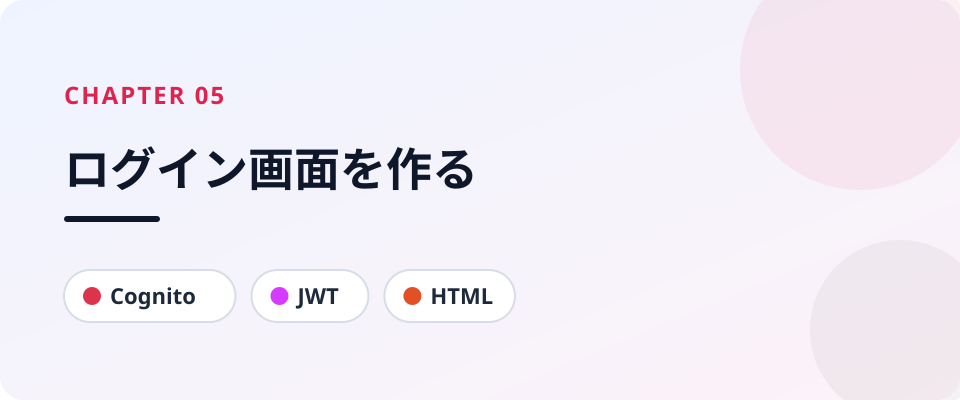
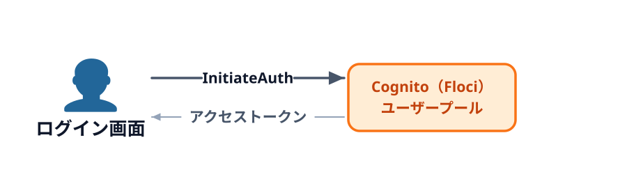

# ログイン画面を作る

前の節で登録したユーザーでログインし、**アクセストークン** を受け取る画面を作ります。API を呼ぶときに付けるのは、このアクセストークンです。

::diff{file="apps/ui/login.html"}

::diff{file="apps/ui/login.js"}

- `InitiateAuth` … `USER_PASSWORD_AUTH` で、メールアドレスとパスワードを送ります
- `AuthenticationResult.AccessToken` … 受け取ったアクセストークンです。画面に出して、次の節から curl で使います

## 動作確認する

画面は nginx がそのまま配るので、作り直さずに読み込み直すだけで使えます。<http://localhost:3000/login.html> を開き、`alice@example.com` と `Passw0rd!` で **ログイン** を押します。「ログインできました」と出て、`eyJ` で始まる長いアクセストークンが出れば大丈夫です。

## 参考にした公式ドキュメント

この節は、次の公式ドキュメントをもとに書いています。

- [Amazon Cognito API: InitiateAuth](https://docs.aws.amazon.com/cognito-user-identity-pools/latest/APIReference/API_InitiateAuth.html) … `USER_PASSWORD_AUTH` と `AuthenticationResult`

## この節を終えたときのディレクトリ

::tree

:::download
[この節を終えた状態をダウンロード](./project.zip)
:::

:::faq

### `NotAuthorizedException: Incorrect username or password` と出る

メールアドレスかパスワードが違います。Floci を起動し直したときは、ユーザーも消えているので、サインアップからやり直してください。

:::
