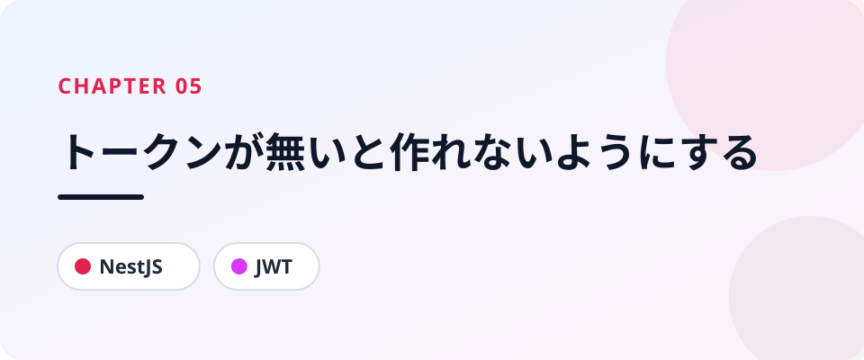
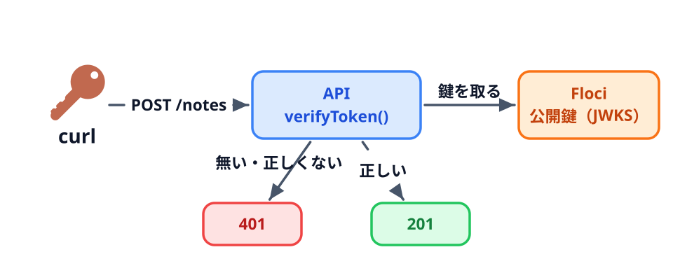

# トークンが無いと作れないようにする



ノートの作成に、正しいアクセストークンを求めます。トークンが無い・正しくないときは `401` にします。



## aws-jwt-verify を入れる

トークンの確認には、AWS が公開している **aws-jwt-verify** を使います。

```bash
cd apps/api
npm install aws-jwt-verify
cd ../..
```

::diff{file="apps/api/package.json" by="command"}

## トークンを確かめる関数を作る

::diff{file="apps/api/src/auth/verify-token.ts"}

- `issuer` … トークンの発行元です。Floci の中の、自分のユーザープールです
- `audience: null` と `customJwtCheck` … Cognito のアクセストークンには `aud` が無いので、代わりに `token_use` と `client_id` を確かめます
- `jwksCache` … aws-jwt-verify は https でしか公開鍵（JWKS）を取りに行かないので、http の Floci から `fetch` で取ります

## コントローラーで確かめる

::diff{file="apps/api/src/notes/notes.controller.ts"}

- `@Headers('authorization')` … `Authorization` ヘッダーの値を受け取ります
- `await verifyToken(authorization)` … 正しくなければ `401` の例外を投げるので、ノートは作られません

## 動作確認する

```bash
podman compose up -d --build --wait
curl -i -X POST http://localhost:3001/notes -H 'Content-Type: application/json' -d '{"title": "買い物", "body": "牛乳を買う"}'
```

1 行目が `HTTP/1.1 401 Unauthorized` で、最後の行が次のようになれば大丈夫です。

```json
{"message":"Missing bearer token","error":"Unauthorized","statusCode":401}
```

## 参考にした公式ドキュメント

この節は、次の公式ドキュメントをもとに書いています。

- [aws-jwt-verify（README）](https://github.com/awslabs/aws-jwt-verify#readme) … `JwtVerifier`・`customJwtCheck`・`SimpleJwksCache`
- [NestJS: Controllers](https://docs.nestjs.com/controllers) … `@Headers()`
- [NestJS: Exception filters](https://docs.nestjs.com/exception-filters) … `UnauthorizedException`

## この節を終えたときのディレクトリ

::tree

:::download
[この節を終えた状態をダウンロード](./project.zip)
:::
