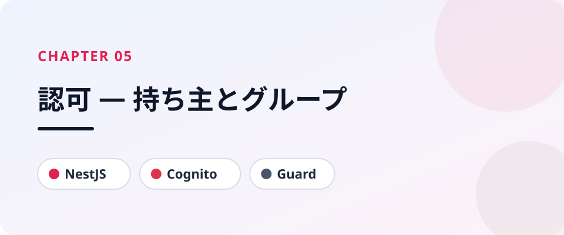

# 認可 — 持ち主とグループ



前の章で、API は「誰からの呼び出しか」が分かるようになりました（認証）。ただ、サインインしていれば、他の人のメモも読めて、消せてしまいます。この節では「**その人に、その操作をさせてよいか**」（認可）を確かめます。

決まりは次のとおりです。

- メモには **持ち主** がいる。作った人が持ち主になる
- 一覧には、自分のメモだけが出る
- 他の人のメモを取得・更新・削除しようとすると `403 Forbidden`
- Cognito の **admin グループ** に入っている人は、全員のメモを扱える

`401` と `403` の違いも押さえておきます。

| ステータス | 意味 | この API で返すとき |
|---|---|---|
| `401 Unauthorized` | 誰か分からない（認証の失敗） | トークンが無い・正しくない |
| `403 Forbidden` | 誰かは分かったが、させられない（認可の失敗） | 他の人のメモを触ろうとした |

## ユーザーとグループを用意する

確かめるには、ユーザーが 2 人要ります。Cognito のコンソールで、次のようにします。

1. ユーザープールの **ユーザー** → **ユーザーを作成** で、2 人目（例: `bob@example.com`）を作る。作り方は 03-01 と同じ
2. **グループ** → **グループを作成** で、グループ名を `admin` にして作る
3. 作った `admin` グループを開き、**ユーザーをグループに追加** で、1 人目（`alice@example.com`）を入れる

グループは、サインインしたときに発行されるトークンの `cognito:groups` に入ります。グループに入れたあとは、画面で **一度サインアウトしてからサインインし直して** ください。「アクセストークンの中身」に、`"cognito:groups": ["admin"]` が出ます。

## ユーザーの型と admin の判定

Guard が `request.user` に入れたトークンの中身を、API の中では「ユーザー」として扱います。型と admin の判定を 1 か所にまとめます。

::diff{file="api/src/auth/user.ts"}

`cognito:groups` は、どのグループにも入っていなければトークンに含まれません。`?.` と `?? false` で、無いときは「admin ではない」にしています。

### トークンの中身を引数で受け取る

`request.user` に入れた中身を、コントローラーのメソッドの引数で受け取れるように、**カスタムデコレーター** を作ります。

::diff{file="api/src/auth/current-user.decorator.ts"}

`@CurrentUser() user` と書くと、`user` に `request.user` が入ります。

## メモに持ち主を持たせる

`Note` に `ownerId` を足します。Cognito の `sub` を入れます。

::diff{file="api/src/notes/entities/note.entity.ts"}

`sub` は、ユーザーごとに決まり、変わらない ID です。メールアドレスは変えられることがあるので、持ち主には `sub` を使います。

## サービスで認可を確かめる

サービスのメソッドに、呼び出したユーザーを渡すようにして、決まりどおりに判定します。

::diff{file="api/src/notes/notes.service.ts"}

- `create` … 持ち主を、呼び出したユーザーの `sub` にします
- `findAll` … admin なら全部、そうでなければ `ownerId` が自分の `sub` のものだけを返します
- `findOne` … 見つからなければ `404`、持ち主でも admin でもなければ `ForbiddenException`（`403`）にします
- `update` と `remove` … 最初に `findOne` を呼ぶので、同じ決まりが掛かります

持ち主を本文（JSON）から受け取らないのが大事です。受け取ると「他の人を持ち主にしたメモ」を作れてしまいます。作成のスキーマは `z.strictObject` なので、本文に `ownerId` を入れて送っても `400`（`Unrecognized key: "ownerId"`）で弾かれます。

## コントローラーからユーザーを渡す

`@CurrentUser()` でユーザーを受け取り、サービスに渡します。

::diff{file="api/src/notes/notes.controller.ts"}

## 認可をテストで確かめる

認可の判定はサービスの中にあるので、Cognito が無くてもテストで確かめられます。テスト用のユーザーを 3 人（alice・bob・admin）用意して、決まりどおりかを確かめます。

::diff{file="api/src/notes/notes.service.spec.ts"}

```bash
npm test
```

```text
 Test Files  2 passed (2)
      Tests  8 passed (8)
```

認可の決まりは、間違えると他の人のデータが見えてしまう大事な部分です。テストにしておくと、あとでコードを変えたときにも壊れていないことを確かめられます。

## 画面に持ち主を出す

メモの下に持ち主（`sub`）を小さく出します。admin でサインインしたときに、他の人のメモも並んでいることが分かります。

::diff{file="api/public/index.html"}

## 動かす

`start:dev` で起動し直すとメモは消えるので、ここから作り直します。

1. `bob@example.com`（admin ではない）でサインインし、メモを作る
2. サインアウトして、`alice@example.com`（admin）でサインインする。1 で作ったメモも一覧に出て、持ち主が自分とは違う `sub` になっている
3. alice で、自分のメモを作る
4. サインアウトして、bob でサインインし直す。3 のメモは一覧に出ない

curl では、他の人のメモの ID を指定すると `403` になります。bob のトークンで、alice のメモを指定します。トークンの取り出し方は 04-01 と同じです。alice のメモの `id` は、alice でサインインしているときの Network タブで、`notes` の応答を見ると分かります。

```bash
curl http://localhost:3000/notes/<alice のメモの id> -H "Authorization: Bearer $TOKEN"
```

```json
{"message":"Note 30be86ed-af27-4a7d-93a7-9e691fe9f303 is not yours","error":"Forbidden","statusCode":403}
```

## 参考にした公式ドキュメント

この節は、次の公式ドキュメントをもとに書いています。

- [Amazon Cognito: Adding groups to a user pool](https://docs.aws.amazon.com/cognito/latest/developerguide/cognito-user-pools-user-groups.html) … グループと、トークンの `cognito:groups`
- [Amazon Cognito: Understanding the access token](https://docs.aws.amazon.com/cognito/latest/developerguide/amazon-cognito-user-pools-using-the-access-token.html) … アクセストークンに入っている項目（`sub`・`cognito:groups`）
- [NestJS: Custom decorators](https://docs.nestjs.com/custom-decorators) … `@CurrentUser()` のような引数のデコレーター
- [NestJS: Exception filters](https://docs.nestjs.com/exception-filters) … `ForbiddenException`・`NotFoundException` などの組み込みの例外

## この節を終えたときのディレクトリ

::tree

:::download
[この節を終えた状態をダウンロード](./project.zip)
:::

:::faq

### admin に入れたのに、全員のメモが見えない

トークンは、サインインしたときのグループで発行されます。一度サインアウトしてからサインインし直してください。「アクセストークンの中身」の `cognito:groups` で確かめられます。

### 他の人のメモが「無い（404）」ではなく「403」になるのはなぜ？

「そのメモはあるが、あなたには触らせない」ことを正直に返しています。ID からメモがあること自体を知られたくないときは、持ち主でなければ `404` を返す作り方もあります。

### グループを増やしたくなったら？

`user.ts` に判定の関数を足し、サービスで使います。グループが多くなってきたら、メソッドごとに「必要なグループ」をデコレーターで書き、Guard で確かめる形にするのが NestJS らしい書き方です。

:::
