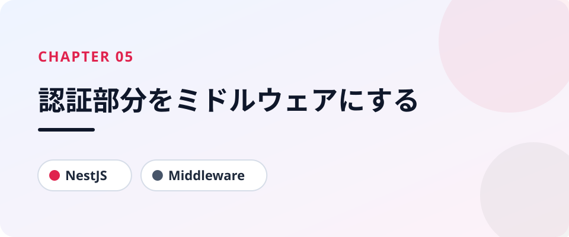

# 認証部分をミドルウェアにする



いまは、作成と削除のメソッドの中で、それぞれ `verifyToken()` を呼んでいます。トークンを確かめるのは「どのメソッドか」ではなく「どのルートか」で決まるので、コントローラーの外の **middleware** にまとめます。動きは変えません。

```text
リクエスト → Middleware（トークンを確かめる）→ コントローラー → 応答
```

## middleware を作る

::diff{file="api/src/auth/auth.middleware.ts"}

- `use(req, res, next)` が、リクエストごとに呼ばれます
- トークンを確かめ、中身を `req.user` に入れてから `next()` で先（コントローラー）に進めます。正しくなければ `verifyToken()` が `401` の例外を投げるので、コントローラーまで進みません

## 作成と削除のルートに掛ける

::diff{file="api/src/app.module.ts"}

- middleware は `configure()` の中で `consumer.apply(...).forRoutes(...)` と書きます。そのため `NestModule` を実装します
- `forRoutes()` に、パスとメソッドの組を並べます。`POST /notes` と `DELETE /notes/:id` にだけ掛けるので、`GET /notes` はこれまでどおり誰でも呼べます

## コントローラーから認証を外す

::diff{file="api/src/notes/notes.controller.ts"}

`@Req()` でリクエストを受け取り、middleware が入れた `req.user.sub` を使います。コントローラーには、ノートの処理だけが残りました。

## 動かす

```bash
podman compose up -d --build --wait
```

03・04 章と同じ確かめをして、同じ結果になることを確かめます。alice と bob のアクセストークンは、ログイン画面で取り直してください。

| 呼び出し | 結果 |
|---|---|
| トークン無しで `POST /notes` | `401` |
| alice のトークンで `POST /notes` | `201`（ノートができる） |
| トークン無しで `GET /notes` | `200`（一覧が見られる） |
| bob のトークンで、alice のノートを `DELETE` | `403` |
| alice のトークンで、alice のノートを `DELETE` | `204` |

## 参考にした公式ドキュメント

この節は、次の公式ドキュメントをもとに書いています。

- [NestJS: Middleware](https://docs.nestjs.com/middleware) … middleware の書き方と、`forRoutes()` でパスとメソッドを指定する方法
- [NestJS: Request lifecycle](https://docs.nestjs.com/faq/request-lifecycle) … middleware がコントローラーより先に動く順番
- [NestJS: Controllers](https://docs.nestjs.com/controllers) … `@Req()`

## この節を終えたときのディレクトリ

::tree

:::download
[この節を終えた状態をダウンロード](./project.zip)
:::
