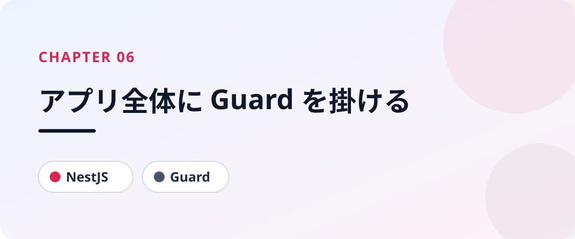

# アプリ全体に Guard を掛ける



04 章では、`@UseGuards(AuthGuard)` を、守りたいコントローラーに付けました。この書き方は「付け忘れたら、誰でも呼べる」という弱点があります。API が増えるほど、付け忘れが起きやすくなります。

この節では、考え方を逆にします。**AuthGuard をアプリ全体に掛けて、すべての API でトークンを必要にし、トークン無しで呼んでよいものだけに `@Public()` を付けます。** 付け忘れても「呼べない」側に倒れるので、安全です。

| 書き方 | 付け忘れたとき |
|---|---|
| 守るものに `@UseGuards` を付ける（04 章） | 誰でも呼べてしまう |
| 全体に掛けて、公開するものに `@Public()` を付ける（この節） | 誰も呼べない（すぐ気づく） |

## @Public() を作る

「このメソッドはトークン無しで呼べる」という印を付けるデコレーターを作ります。

::diff{file="api/src/auth/public.decorator.ts"}

`SetMetadata(キー, 値)` は、メソッドやクラスに **メタデータ**（コードの動きとは別に付けておく情報）を付けるデコレーターです。ここでは `isPublic: true` を付けます。

## Guard で @Public() を見る

AuthGuard の最初で、メタデータを読みます。

::diff{file="api/src/auth/auth.guard.ts"}

- `Reflector` … NestJS が用意している、メタデータを読むための部品です。コンストラクターで受け取ります
- `getAllAndOverride(IS_PUBLIC_KEY, [context.getHandler(), context.getClass()])` … 呼ばれるメソッドと、そのコントローラーの両方を見て、`isPublic` が付いていれば `true` を返します。メソッドに付けたものが優先されます
- `@Public()` なら、トークンを確かめずに `true` を返して通します

## アプリ全体に掛ける

`APP_GUARD` という名前で Guard を登録すると、アプリのすべてのルートに掛かります。`AuthModule` に登録します。

::diff{file="api/src/auth/auth.module.ts"}

## @UseGuards を外し、@Public() を付ける

メモのコントローラーからは `@UseGuards(AuthGuard)` を外します。アプリ全体の Guard が掛かるので、要らなくなりました。

::diff{file="api/src/notes/notes.controller.ts"}

`/auth/config` は、サインインする前に画面が呼ぶので、`@Public()` を付けます。付けないと、画面がサインインできなくなります。

::diff{file="api/src/auth/auth.controller.ts"}

コントローラーが Guard を直接使わなくなったので、テストの `overrideGuard` も要らなくなります。テストのモジュールには `APP_GUARD` を登録していないので、Guard は作られません。

::diff{file="api/src/notes/notes.controller.spec.ts"}

## 動かす

:::::platform
::::macos-linux
```bash
curl -s -o /dev/null -w "%{http_code}\n" http://localhost:3000/
curl -s -o /dev/null -w "%{http_code}\n" http://localhost:3000/auth/config
curl -s -o /dev/null -w "%{http_code}\n" http://localhost:3000/notes
curl -s -o /dev/null -w "%{http_code}\n" -X DELETE http://localhost:3000/notes/abc
```
::::
::::windows
Windows では、捨て先の `/dev/null` の代わりに `NUL` と書きます。

```powershell
curl -s -o NUL -w "%{http_code}\n" http://localhost:3000/
curl -s -o NUL -w "%{http_code}\n" http://localhost:3000/auth/config
curl -s -o NUL -w "%{http_code}\n" http://localhost:3000/notes
curl -s -o NUL -w "%{http_code}\n" -X DELETE http://localhost:3000/notes/abc
```
::::
:::::

```text
200
200
401
401
```

- `GET /`（画面）は `200`。`public/` のファイルは、Guard より前に、`useStaticAssets` が返しているからです
- `GET /auth/config` は `@Public()` なので、トークン無しで `200`
- `GET /notes` は、何も付けていないので `401`
- `DELETE /notes/abc` は、ID が UUID ではありませんが、`400` ではなく `401` です。入力チェック（Pipe）より Guard が先に動くからです

画面からは、これまでどおりサインインすればメモを読み書きできます。

## 参考にした公式ドキュメント

この節は、次の公式ドキュメントをもとに書いています。

- [NestJS: Guards](https://docs.nestjs.com/guards) … `APP_GUARD` でアプリ全体に掛ける方法
- [NestJS: Authentication](https://docs.nestjs.com/security/authentication) … アプリ全体に Guard を掛け、開けておくルートに `@Public()` を付ける考え方（公式パッケージ版。この節では自分で作っています）
- [NestJS: Execution context](https://docs.nestjs.com/fundamentals/execution-context) … `Reflector` と `SetMetadata` でメタデータを読み書きする
- [NestJS: Request lifecycle](https://docs.nestjs.com/faq/request-lifecycle) … Guard が Pipe より先に動く順番

## この節を終えたときのディレクトリ

::tree

:::download
[この節を終えた状態をダウンロード](./project.zip)
:::

:::faq

### 新しい API を足したら 401 になった

アプリ全体に Guard が掛かっているので、正しい動きです。トークン無しで呼べるようにしたいときだけ、`@Public()` を付けてください。

### コントローラーごと公開したい

`@Public()` をクラス（`@Controller()` の上）に付けます。`getAllAndOverride` はコントローラーに付いた印も見るので、すべてのメソッドが公開になります。

### 画面がサインインできなくなった

`/auth/config` に `@Public()` が付いているか確かめてください。付いていないと、画面は ID を受け取れません。

:::
