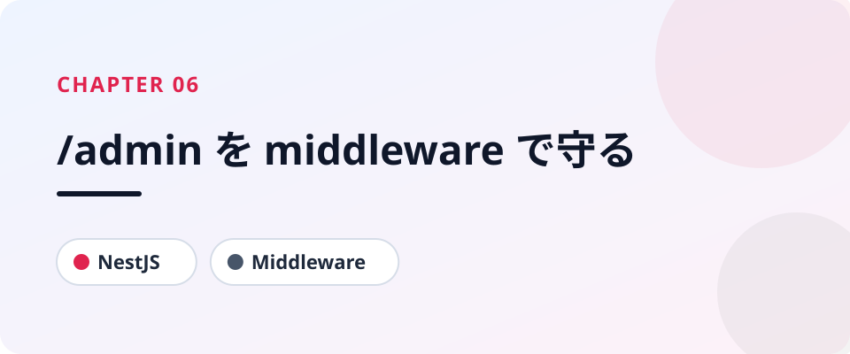

# /admin を middleware で守る



前の節の `@Public()` は、メソッドやコントローラーごとに決まりを付ける方法でした。この節では、**middleware** で **パス**（URL）ごとに決まりを付けます。管理用の API を `/admin` の下にまとめ、`/admin` の下はまるごと admin グループの人だけが使えるようにします。

## NestJS がリクエストを処理する順番

```text
リクエスト → Middleware → Guard → Pipe → コントローラー → 応答
                  （どこかで例外が起きると、エラーの応答になる）
```

middleware は、Guard より先に動きます。その時点では、まだ Guard がトークンを確かめていないので、`request.user` はありません。

## トークンの検証を切り出す

middleware でもトークンを確かめる必要があるので、Guard の中にあった検証を、`TokenVerifier` として切り出します。Guard と middleware の両方から使います。

::diff{file="api/src/auth/token-verifier.ts"}

Guard は `TokenVerifier` を使う形に書き換えます。

::diff{file="api/src/auth/auth.guard.ts"}

`if (request.user) return true;` は、「middleware がもう検証していれば、もう一度は確かめない」という意味です。

`AuthModule` で `TokenVerifier` を登録し、ほかのモジュールからも使えるように `exports` に入れます。

::diff{file="api/src/auth/auth.module.ts"}

## admin 専用の middleware を作る

::diff{file="api/src/admin/admin.middleware.ts"}

- `use(req, res, next)` が、リクエストごとに呼ばれます。`next()` を呼ぶと次の段（Guard）へ進みます
- トークンを確かめ、admin グループでなければ `ForbiddenException`（`403`）を投げます
- 確かめたユーザーを `req.user` に入れておくので、コントローラーで `@CurrentUser()` が使えます

## 管理用の API を作る

全員のメモを返す `GET /admin/notes` を作ります。

::diff{file="api/src/admin/admin.controller.ts"}

`NotesService` を `AdminModule` からも使うので、`NotesModule` で公開します。

::diff{file="api/src/notes/notes.module.ts"}

`AdminModule` で、middleware をパスに掛けます。

::diff{file="api/src/admin/admin.module.ts"}

- middleware は `configure()` の中で `consumer.apply(...).forRoutes(...)` と書きます
- `'admin{/*splat}'` は「`/admin` と、その下のすべて」です

`AppModule` で読み込みます。

::diff{file="api/src/app.module.ts"}

## 動かす

admin のユーザー（alice）のトークンなら、全員のメモが返ります。

```bash
curl http://localhost:3000/admin/notes -H "Authorization: Bearer $TOKEN"
```

admin でないユーザー（bob）のトークンだと `403` です。

```json
{"message":"Admin only","error":"Forbidden","statusCode":403}
```

トークン無しなら `401` です。存在しない `/admin` を呼んでも `404` ではなく `401` になります。middleware は、ルートがあるかより先に、パスだけを見て動くからです。

:::::platform
::::macos-linux
```bash
curl -s -o /dev/null -w "%{http_code}\n" http://localhost:3000/admin/notes
curl -s -o /dev/null -w "%{http_code}\n" http://localhost:3000/admin
```
::::
::::windows
```powershell
curl -s -o NUL -w "%{http_code}\n" http://localhost:3000/admin/notes
curl -s -o NUL -w "%{http_code}\n" http://localhost:3000/admin
```
::::
:::::

```text
401
401
```

## Guard と middleware の使い分け

Guard はメソッド・コントローラー単位で決め、`@Public()` のようなメタデータを読めます。middleware はパス単位で決め、メタデータは読めません。ふだんの認証は Guard、`/admin` の下のように「パスでまとめて決めたい」ものは middleware、と使い分けます。

## 本物の Cognito で動かすには

コードは変えずに、`api/.env` の 3 つの値を変えます。発行元（`iss`）と公開鍵の場所は、どちらも `COGNITO_ENDPOINT` とユーザープール ID から決まるので、Floci でも本物でも同じ書き方で確かめられます。

```ini
COGNITO_ENDPOINT=https://cognito-idp.ap-northeast-1.amazonaws.com
COGNITO_USER_POOL_ID=<本物のユーザープール ID>
COGNITO_USER_POOL_CLIENT_ID=<本物のクライアント ID>
```

ユーザープールは、`scripts/setup-cognito.mjs` と同じ設定（クライアントシークレットなし・`ALLOW_USER_PASSWORD_AUTH`・`admin` グループ）で作ります。

## 参考にした公式ドキュメント

この節は、次の公式ドキュメントをもとに書いています。

- [NestJS: Middleware](https://docs.nestjs.com/middleware) … middleware の書き方と `forRoutes()`、`{/*splat}` の書き方
- [NestJS: Request lifecycle](https://docs.nestjs.com/faq/request-lifecycle) … middleware・Guard・Pipe が動く順番
- [NestJS: Modules](https://docs.nestjs.com/modules) … `exports` で、ほかのモジュールにプロバイダーを公開する
- [Amazon Cognito: Verifying JSON web tokens](https://docs.aws.amazon.com/cognito/latest/developerguide/amazon-cognito-user-pools-using-tokens-verifying-a-jwt.html) … 本物の Cognito の発行元（`https://cognito-idp.<リージョン>.amazonaws.com/<ユーザープール ID>`）と JWKS の場所

## この節を終えたときのディレクトリ

::tree

:::download
[この節を終えた状態をダウンロード](./project.zip)
:::
