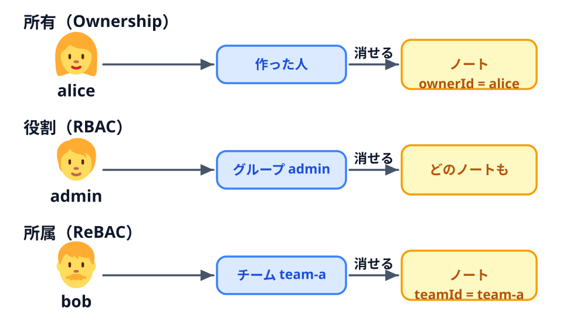

# 認可の種類

この章では、ノートを消せる人を決める **認可** を、よく使われる 3 つの種類で順に足していきます。この節では、3 つの種類を比べ、確かめる呼び出しを決めます。コードは書きません。

| 節 | 種類 | 決め手 | どこで分かるか |
|---|---|---|---|
| 所有で認可する | 所有（Ownership） | ノートを作った人か | ノートの `ownerId` と、トークンの `sub` |
| 役割で認可する | 役割（RBAC、Role-Based Access Control） | `admin` のグループに入っているか | トークンの `cognito:groups` |
| 所属で認可する | 所属（ReBAC、Relationship-Based Access Control） | ノートのチームに入っているか | ノートの `teamId` と、API の SQLite の `team_members` |

3 つは、節ごとに足していきます。最後の節では「作った人・`admin` の人・同じチームの人のどれか」なら消せます。

もっと広い考え方に **属性（ABAC、Attribute-Based Access Control）** があります。人やノートの属性を組み合わせて決めるもので、所有も所属も「ノートの `ownerId`」「人のチーム」という属性の決まりとして書けます。

## 401 と 403

| 返すもの | 意味 | このハンズオンでの例 |
|---|---|---|
| `401 Unauthorized` | 誰か分からない（認証の失敗） | トークンが無い・正しくない |
| `403 Forbidden` | 誰かは分かったが、させられない（認可の失敗） | トークンは正しいが、消してよい人ではない |

## 確かめる呼び出し

ユーザーは次の 3 人です。

| ユーザー | どんな人か |
|---|---|
| `alice@example.com` | ノートを作る人 |
| `bob@example.com` | ほかの人。所属で認可する節で、チーム `team-a` に入れる |
| `admin@example.com` | グループ `admin` の人。セットアップのスクリプトが作る |

alice が作ったノートを消す呼び出しと、各節の終わりに返るものです。

| 呼び出し | 所有 | 役割 | 所属 |
|---|---|---|---|
| トークン無し | `401` | `401` | `401` |
| alice のトークン | `204` | `204` | `204` |
| bob のトークン | `403` | `403` | `403`（ノートが `team-a` のもので、bob を `team-a` に入れると `204`） |
| admin のトークン | `403` | `204` | `204` |

## 参考にした公式ドキュメント

この節は、次の公式ドキュメントをもとに書いています。

- [RFC 9110: HTTP Semantics](https://www.rfc-editor.org/rfc/rfc9110.html#name-403-forbidden) … `401 Unauthorized` と `403 Forbidden` の違い
- [NIST: Role Based Access Control](https://csrc.nist.gov/projects/role-based-access-control) … 役割での認可（RBAC）
- [NIST SP 800-162: Guide to Attribute Based Access Control (ABAC)](https://csrc.nist.gov/pubs/sp/800/162/upd2/final) … 属性での認可（ABAC）
