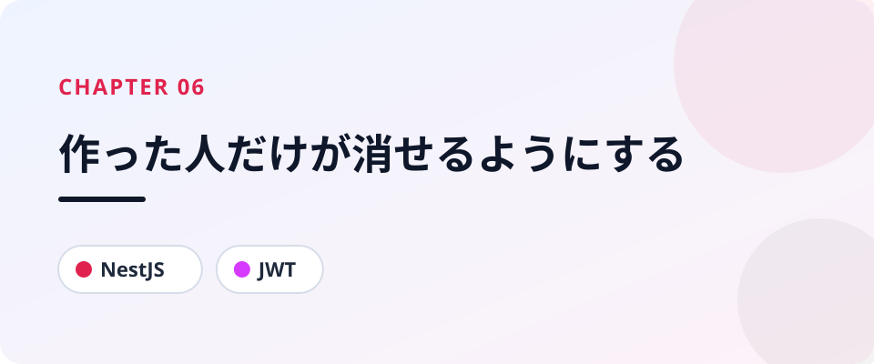

# 作った人だけが消せるようにする



この章では、03 章で設計したとおりに、**ノートを消せるのは作った人だけ** にします（**認可**）。この節では、削除にもトークンを求め、トークンの `sub` とノートの `ownerId` を比べます。

::diff{file="api/src/notes/notes.controller.ts"}

- `SELECT ownerId FROM notes WHERE id = ?` … 消す前に、ノートの作った人を読みます。無ければ `404` です
- `note.ownerId !== user.sub` … 作った人でなければ `ForbiddenException`（`403`）を投げます
- 認証（`verifyToken`）が先なので、トークンが無ければ、ノートがあるかどうかに関係なく `401` です

## 動作確認する

```bash
podman compose up -d --build --wait
```

前の節で作ったノートの ID と、ログインし直したアクセストークンに置き換えて送ります。

```bash
curl -i -X DELETE http://localhost:3001/notes/21a481a3-b808-4653-a833-89ffe6a9db37
```

1 行目が `HTTP/1.1 401 Unauthorized` になれば大丈夫です。ほかの人のトークンで送ったとき（`403`）と、作った人のトークンで送ったとき（`204`）は、次の 2 つの節で確かめます。

## 参考にした公式ドキュメント

この節は、次の公式ドキュメントをもとに書いています。

- [NestJS: Exception filters](https://docs.nestjs.com/exception-filters) … `ForbiddenException`・`NotFoundException`
- [Node.js: SQLite](https://nodejs.org/docs/latest-v26.x/api/sqlite.html) … `statement.get()`

## この節を終えたときのディレクトリ

::tree

:::download
[この節を終えた状態をダウンロード](./project.zip)
:::
