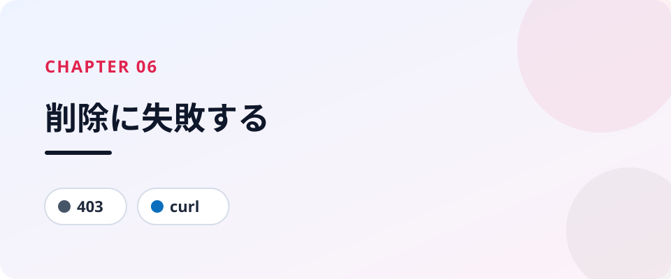

# 削除に失敗する



alice が作ったノートを、別のユーザー（bob）のトークンで消そうとして、`403` になることを確かめます。コードは変えません。

## bob を登録してログインする

<http://localhost:3000/signup.html> で `bob@example.com` とパスワード `Passw0rd!` を登録し（確認コードは <http://localhost:4566/_aws/ses> で読みます）、<http://localhost:3000/login.html> でログインして、bob のアクセストークンを出します。

## 動作確認する

alice が作ったノートの ID と、bob のアクセストークンに置き換えて送ります。

```bash
curl -i -X DELETE http://localhost:3001/notes/21a481a3-b808-4653-a833-89ffe6a9db37 -H 'Authorization: Bearer <bob のアクセストークン>'
```

1 行目が `HTTP/1.1 403 Forbidden` で、最後の行が次のようになれば大丈夫です。bob は誰かは分かっていますが、alice のノートは消せません。

```json
{"message":"Forbidden","statusCode":403}
```

<http://localhost:3000/notes.html> を開くと、ノートは消えずに残っています。

## 参考にした公式ドキュメント

この節は、次の公式ドキュメントをもとに書いています。

- [RFC 9110: HTTP Semantics](https://www.rfc-editor.org/rfc/rfc9110.html#name-403-forbidden) … `403 Forbidden`
