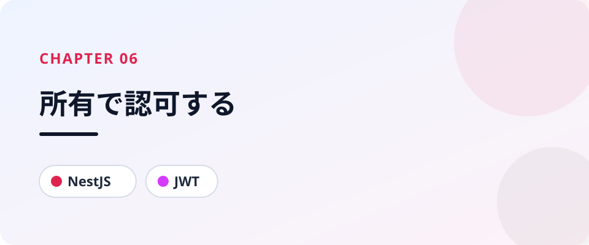

# 所有で認可する



**所有** で認可します。ノートを消せるのは、作った人だけです。削除にもトークンを求め、トークンの `sub` とノートの `ownerId` を比べます。

::diff{file="apps/api/src/notes/notes.controller.ts"}

- `SELECT ownerId FROM notes WHERE id = ?` … 消す前に、ノートの作った人を読みます。無ければ `404` です
- `note.ownerId !== user.sub` … 作った人でなければ `ForbiddenException`（`403`）を投げます
- 認証（`verifyToken`）が先なので、トークンが無ければ、ノートがあるかどうかに関係なく `401` です

## 動作確認する

```bash
podman compose up -d --build --wait
```

<http://localhost:3000/login.html> で alice としてログインし、alice のトークンでノートを作ります（05 章の最後と同じです）。次に <http://localhost:3000/signup.html> で `bob@example.com` とパスワード `Passw0rd!` を登録し（確認コードは <http://localhost:4566/_aws/ses> で読みます）、ログインして bob のトークンも出します。

ノートの ID とトークンに置き換えて、順に送ります。

```bash
curl -i -X DELETE http://localhost:3001/notes/21a481a3-b808-4653-a833-89ffe6a9db37
curl -i -X DELETE http://localhost:3001/notes/21a481a3-b808-4653-a833-89ffe6a9db37 -H 'Authorization: Bearer <bob のアクセストークン>'
curl -i -X DELETE http://localhost:3001/notes/21a481a3-b808-4653-a833-89ffe6a9db37 -H 'Authorization: Bearer <alice のアクセストークン>'
```

1 行目が、順に `HTTP/1.1 401 Unauthorized`、`HTTP/1.1 403 Forbidden`、`HTTP/1.1 204 No Content` になれば大丈夫です。bob は誰かは分かっていますが、alice のノートは消せません。<http://localhost:3000/notes.html> を読み込み直すと、alice が消したノートは無くなっています。

## 参考にした公式ドキュメント

この節は、次の公式ドキュメントをもとに書いています。

- [NestJS: Exception filters](https://docs.nestjs.com/exception-filters) … `ForbiddenException`・`NotFoundException`
- [Node.js: SQLite](https://nodejs.org/docs/latest-v26.x/api/sqlite.html) … `statement.get()`

## この節を終えたときのディレクトリ

::tree

:::download
[この節を終えた状態をダウンロード](./project.zip)
:::
