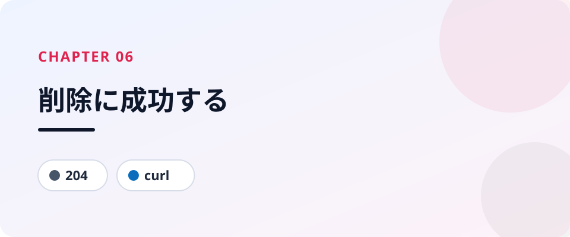

# 削除に成功する



alice が作ったノートを、alice のトークンで消して、`204` になることを確かめます。コードは変えません。

## 動作確認する

<http://localhost:3000/login.html> で alice としてログインし、ノートの ID と alice のアクセストークンに置き換えて送ります。

```bash
curl -i -X DELETE http://localhost:3001/notes/21a481a3-b808-4653-a833-89ffe6a9db37 -H 'Authorization: Bearer <alice のアクセストークン>'
```

1 行目が `HTTP/1.1 204 No Content` になれば大丈夫です。<http://localhost:3000/notes.html> を読み込み直して、ノートが消えていれば成功です。

これで、03 章で設計した認証（`401`）と認可（`403`）がそろいました。

## 参考にした公式ドキュメント

この節は、次の公式ドキュメントをもとに書いています。

- [RFC 9110: HTTP Semantics](https://www.rfc-editor.org/rfc/rfc9110.html#name-204-no-content) … `204 No Content`
