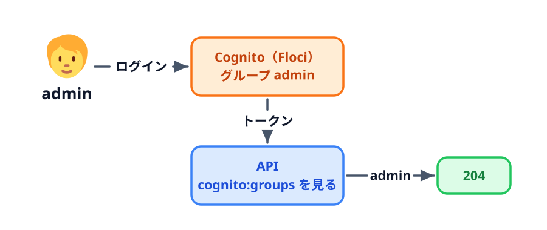

# 役割で認可する


**役割** で認可します。Cognito の **グループ** `admin` に入っている人は、だれのノートでも消せるようにします。グループはアクセストークンの `cognito:groups` に入るので、API はトークンを見るだけで分かります。



## グループと管理者を作る

セットアップのスクリプトで、グループ `admin` と、そこに入れる管理者のユーザー `admin@example.com` を作ります。

::diff{file="apps/api/scripts/setup-cognito.mjs"}

- `CreateGroup` … グループを作ります
- `AdminCreateUser`・`AdminSetUserPassword` … サインアップの画面を通さずにユーザーを作り、パスワードを決めます（`MessageAction: 'SUPPRESS'` で、招待のメールは送りません）
- `AdminAddUserToGroup` … ユーザーをグループに入れます

## admin なら消せるようにする

::diff{file="apps/api/src/notes/notes.controller.ts"}

- `user['cognito:groups']` … トークンに入っているグループの配列です。グループに入っていない人には、この項目がありません

## 動作確認する

スクリプトを変えたので、Floci を起動し直して作り直します。Floci のユーザーは消えるので、alice と bob はサインアップし直します。

```bash
podman compose down
podman compose up -d --build --wait
node apps/api/scripts/setup-cognito.mjs
podman compose up -d --wait
```

<http://localhost:3000/login.html> で `admin@example.com` と `Passw0rd!` でログインし、出たアクセストークンの中身を見ます。

```bash
node -e "console.log(JSON.parse(Buffer.from(process.argv[1].split('.')[1], 'base64url')))" <アクセストークン>
```

`'cognito:groups': [ 'admin' ]` が入っていれば大丈夫です。

alice と bob をサインアップし直し、alice のトークンでノートを作ります。そのノートを、bob と admin のトークンで消します。

```bash
curl -i -X DELETE http://localhost:3001/notes/21a481a3-b808-4653-a833-89ffe6a9db37 -H 'Authorization: Bearer <bob のアクセストークン>'
curl -i -X DELETE http://localhost:3001/notes/21a481a3-b808-4653-a833-89ffe6a9db37 -H 'Authorization: Bearer <admin のアクセストークン>'
```

1 行目が、順に `HTTP/1.1 403 Forbidden`、`HTTP/1.1 204 No Content` になれば大丈夫です。

:::notice[グループの変更が効くのは、次のトークンから]
グループを変えても、すでに配ったトークンの中身は変わりません。トークンは「発行したときの情報」の写しだからです。新しいグループが効くのは、ログインし直すかトークンを更新したあとです。
:::

## 参考にした公式ドキュメント

この節は、次の公式ドキュメントをもとに書いています。

- [Amazon Cognito: Adding groups to a user pool](https://docs.aws.amazon.com/cognito/latest/developerguide/cognito-user-pools-user-groups.html) … グループと、トークンの `cognito:groups`
- [Amazon Cognito API: CreateGroup](https://docs.aws.amazon.com/cognito-user-identity-pools/latest/APIReference/API_CreateGroup.html) … グループを作る
- [Amazon Cognito API: AdminCreateUser](https://docs.aws.amazon.com/cognito-user-identity-pools/latest/APIReference/API_AdminCreateUser.html) … `MessageAction`
- [Amazon Cognito API: AdminSetUserPassword](https://docs.aws.amazon.com/cognito-user-identity-pools/latest/APIReference/API_AdminSetUserPassword.html) … `Permanent`
- [Amazon Cognito API: AdminAddUserToGroup](https://docs.aws.amazon.com/cognito-user-identity-pools/latest/APIReference/API_AdminAddUserToGroup.html) … ユーザーをグループに入れる

## この節を終えたときのディレクトリ

::tree

:::download
[この節を終えた状態をダウンロード](./project.zip)
:::
