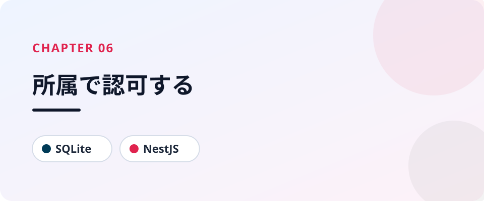
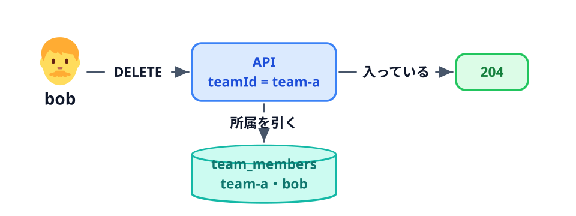

# 所属で認可する



**所属** で認可します。ノートにチームを持たせ、そのチームに入っている人も消せるようにします。だれがどのチームに入っているかは、API の SQLite に持ちます。



## チームと所属の表を作る

::diff{file="apps/api/src/database.ts"}

- `notes` の `teamId` … ノートを分け合うチームです。無ければ `null` です
- `teams` … チームの表です
- `team_members` … だれ（`userId`、トークンの `sub`）がどのチーム（`teamId`）に入っているかの表です

## 同じチームの人なら消せるようにする

::diff{file="apps/api/src/notes/notes.controller.ts"}

- `input.teamId ?? null` … ノートを作るときに、チームを送れます
- `SELECT 1 FROM team_members WHERE teamId = ? AND userId = ?` … ノートのチームに、トークンの人が入っているかを、消すたびに表で確かめます

## 所属を出し入れするスクリプトを作る

メールアドレスでチームに足したり外したりするスクリプトです。API のコンテナの中で動かし、Cognito でメールアドレスから `sub` を調べて、SQLite に書きます。

::diff{file="apps/api/scripts/team-member.js"}

## 動作確認する

テーブルの形を変えたので、データベースのボリュームごと作り直します。Floci のユーザーも消えるので、alice と bob はサインアップし直します。

```bash
podman compose down --volumes
podman compose up -d --build --wait
node apps/api/scripts/setup-cognito.js
podman compose up -d --wait
```

alice と bob をサインアップし直してログインし、alice のトークンで、チーム `team-a` のノートを作ります。

```bash
curl -i -X POST http://localhost:3001/notes -H 'Authorization: Bearer <alice のアクセストークン>' -H 'Content-Type: application/json' -d '{"title": "チームの買い物", "body": "牛乳を買う", "teamId": "team-a"}'
```

bob のトークンで消すと、まだ `HTTP/1.1 403 Forbidden` です。bob を `team-a` に入れます。

```bash
podman compose exec api node scripts/team-member.js add bob@example.com team-a
```

同じ bob のトークンで、もう一度消します。

```bash
curl -i -X DELETE http://localhost:3001/notes/<ノートの ID> -H 'Authorization: Bearer <bob のアクセストークン>'
```

1 行目が `HTTP/1.1 204 No Content` になれば大丈夫です。所属は消すたびに表で確かめるので、トークンを取り直さなくても、すぐに効きます。

## 参考にした公式ドキュメント

この節は、次の公式ドキュメントをもとに書いています。

- [Node.js: SQLite](https://nodejs.org/docs/latest-v26.x/api/sqlite.html) … `prepare()`・`get()`・`run()`
- [Amazon Cognito API: AdminGetUser](https://docs.aws.amazon.com/cognito-user-identity-pools/latest/APIReference/API_AdminGetUser.html) … ユーザーの属性（`sub`）を読む
- [Docker: docker compose exec](https://docs.docker.com/reference/cli/docker/compose/exec/) … 動いているコンテナでコマンドを実行する

## この節を終えたときのディレクトリ

::tree

:::download
[この節を終えた状態をダウンロード](./project.zip)
:::
