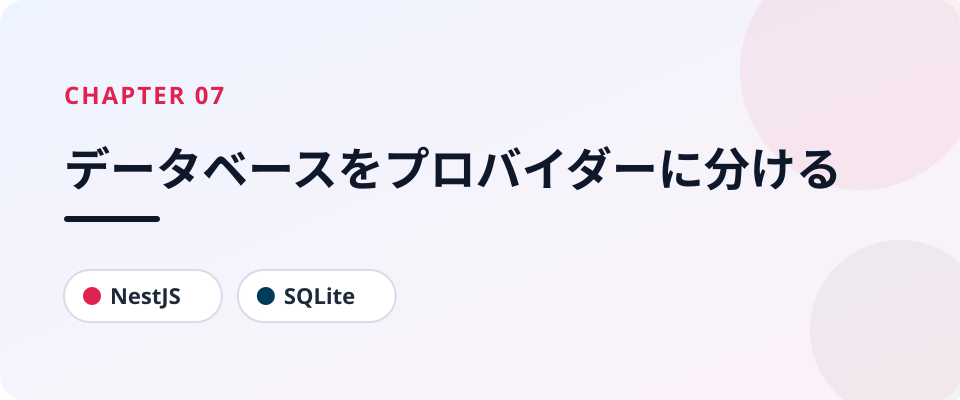
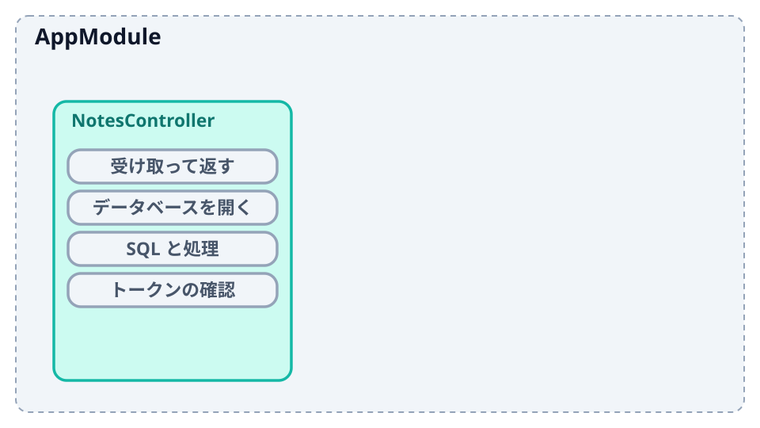
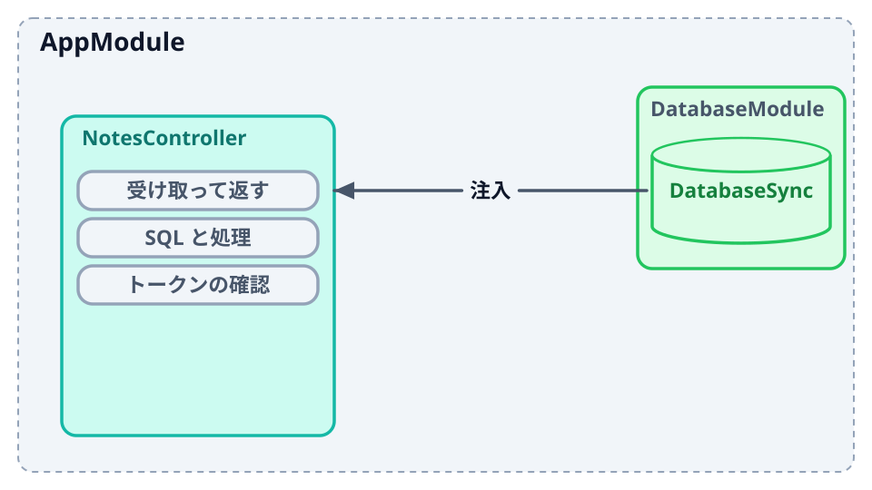

# データベースをプロバイダーに分ける



04〜06 章では、データベース・認証・認可のすべてをコントローラーに直接書きました。この章では、動きを変えずに、NestJS の標準の形に 1 つずつ分けていきます。各節の最後に、06 章の最後と同じ動作確認をします。

今は、すべてが `NotesController` の中にあります。この章の図では、節ごとに、その節で分けたものに色を付けます。



最初は、データベースです。コントローラーが自分で `openDatabase()` を呼ぶのをやめ、NestJS に **プロバイダー** として渡してもらいます。データベースはノート以外の機能からも使うものなので、`DatabaseModule` という **モジュール** にまとめます。



```bash
cd apps/api
npx nest g module database
cd ../..
```

```text
CREATE src/database/database.module.ts (85 bytes)
UPDATE src/app.module.ts (413 bytes)
```

`nest g module` は、`AppModule` の `imports` に `DatabaseModule` を足します。

::diff{file="apps/api/src/app.module.ts" by="command"}

`src/database.ts` を、できた `src/database/` フォルダに移します（中身は変えません）。

::diff{file="apps/api/src/database/database.module.ts" base="generated"}

- `{ provide: DatabaseSync, useFactory: openDatabase }` … 「`DatabaseSync` を受け取りたいクラスには、`openDatabase()` が返したものを渡す」という登録です。NestJS は `openDatabase()` を 1 回だけ呼び、同じデータベースを使い回します
- `exports: [DatabaseSync]` … `DatabaseModule` を読み込んだモジュール（ここでは `AppModule`）でも、`DatabaseSync` を受け取れるようにします

::diff{file="apps/api/src/notes/notes.controller.ts"}

- `constructor(private readonly db: DatabaseSync)` … 引数の型を見て、NestJS が `DatabaseModule` で登録したデータベースを渡します（02 章の `AppService` と同じ依存性の注入です）

## 動作確認する

`podman compose up -d --build --wait` で作り直して起動し、06 章の最後と同じように curl で送ります。alice が作ったノートに対して、次のとおりになれば、整理しても動きは変わっていません。

| 呼び出し | 返るもの |
|---|---|
| トークン無しで作る | `401` |
| alice のトークンで作る | `201` |
| bob のトークンで消す（チームの無いノート） | `403` |
| admin のトークンで消す | `204` |
| bob のトークンで消す（bob が入っている `team-a` のノート） | `204` |

## 参考にした公式ドキュメント

この節は、次の公式ドキュメントをもとに書いています。

- [NestJS: Custom providers](https://docs.nestjs.com/fundamentals/custom-providers) … `provide` と `useFactory`
- [NestJS: Modules](https://docs.nestjs.com/modules) … `exports` でプロバイダーをほかのモジュールに渡す（Shared modules）

## この節を終えたときのディレクトリ

::tree

:::download
[この節を終えた状態をダウンロード](./project.zip)
:::
