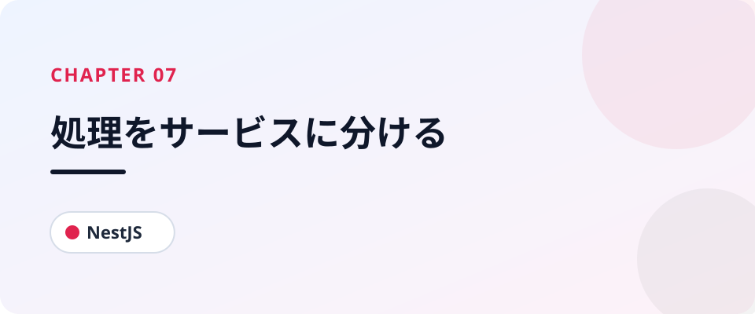
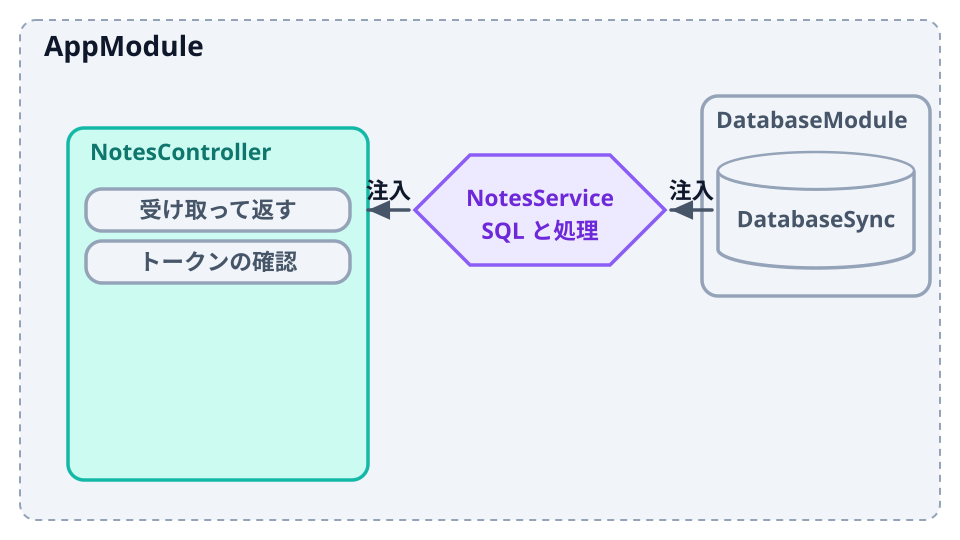

# 処理をサービスに分ける



SQL と処理（作った人かどうかの判定も）を **サービス** に移し、コントローラーは「トークンを確かめて、サービスを呼んで、返す」だけにします。データベースは、コントローラーではなくサービスに注入します。



```bash
npx nest g service notes
```

```text
CREATE src/notes/notes.service.spec.ts (456 bytes)
CREATE src/notes/notes.service.ts (89 bytes)
UPDATE src/app.module.ts (484 bytes)
```

`AppModule` の `providers` に `NotesService` が登録されます。

::diff{file="api/src/app.module.ts" by="command"}

::diff{file="api/src/notes/notes.service.ts" base="generated"}

- メソッドの中身は、コントローラーにあったものをそのまま移しています。作った人の ID は、引数で受け取ります
- データベースは、サービスのコンストラクターで受け取ります

::diff{file="api/src/notes/notes.controller.ts"}

- トークンの確認（`verifyToken`）と応答のステータス（`@HttpCode(204)`）は、HTTP の決まりなのでコントローラーに残します

## 動作確認する

`podman compose up -d --build --wait` で作り直して起動し、06 章の最後と同じように curl で送ります。トークンが無い作成は `401`、alice のトークンでの作成は `201`、bob のトークンでの削除は `403`、alice のトークンでの削除は `204` になれば、整理しても動きは変わっていません。

## 参考にした公式ドキュメント

この節は、次の公式ドキュメントをもとに書いています。

- [NestJS: Providers](https://docs.nestjs.com/providers) … サービス（`@Injectable()`）と依存性の注入

## この節を終えたときのディレクトリ

::tree

:::download
[この節を終えた状態をダウンロード](./project.zip)
:::
