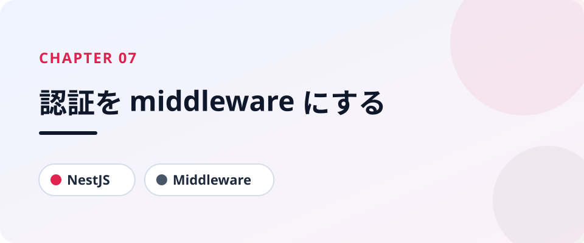
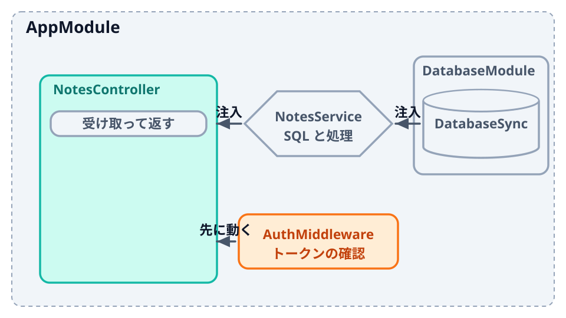

# 認証を middleware にする

作成と削除の両方で、コントローラーが最初に `verifyToken()` を呼んでいます。この確認を **middleware** にまとめ、コントローラーに届く前に済ませます。

::diff{file="apps/api/src/auth/auth.middleware.ts"}

- `req.user = await verifyToken(...)` … 正しければトークンの中身を `req.user` に入れて `next()` で先へ進めます。正しくなければ `verifyToken` が `401` にします

作成と削除にだけ掛けます。一覧は誰でも見られるので掛けません。

::diff{file="apps/api/src/app.module.ts"}

- `forRoutes()` … middleware を掛ける URL とメソッドを選びます

::diff{file="apps/api/src/notes/notes.controller.ts"}

- `@Req() req: AuthenticatedRequest` … middleware が入れた `req.user` から、ユーザーの `sub` を読みます

## 動作確認する

`podman compose up -d --build --wait` で作り直して起動し、06 章の最後と同じように curl で送ります。alice が作ったノートに対して、次のとおりになれば、整理しても動きは変わっていません。

| 呼び出し | 返るもの |
|---|---|
| トークン無しで作る | `401` |
| alice のトークンで作る | `201` |
| bob のトークンで消す（チームの無いノート） | `403` |
| admin のトークンで消す | `204` |
| bob のトークンで消す（bob が入っている `team-a` のノート） | `204` |

## 参考にした公式ドキュメント

この節は、次の公式ドキュメントをもとに書いています。

- [NestJS: Middleware](https://docs.nestjs.com/middleware) … `NestMiddleware` と、`consumer.apply().forRoutes()` で掛ける URL とメソッドを選ぶ

## この節を終えたときのディレクトリ

::tree

:::download
[この節を終えた状態をダウンロード](./project.zip)
:::
