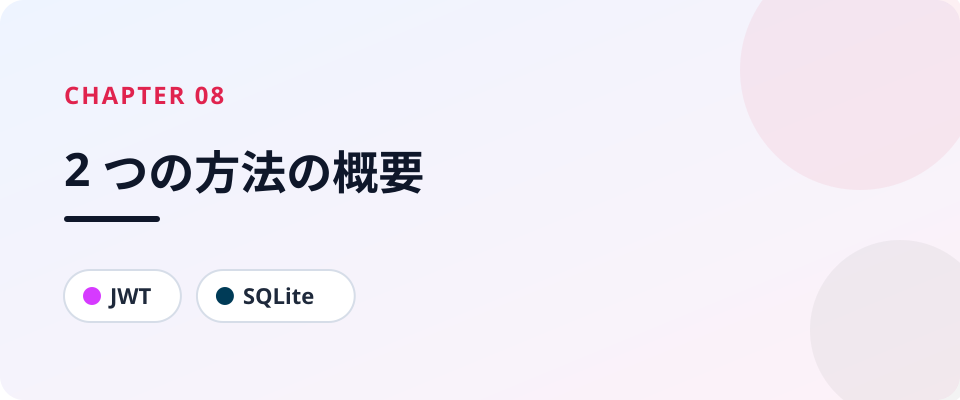
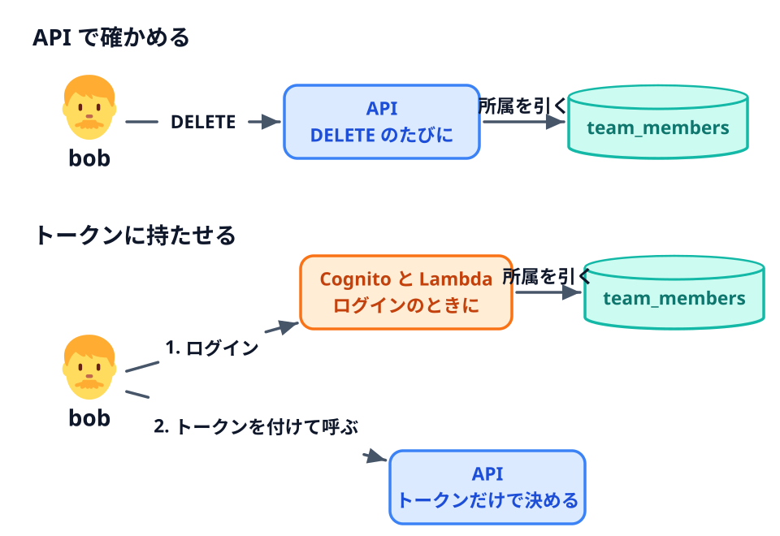

# 2 つの方法の概要

06 章の「所属で認可する」では、消すたびに API が SQLite の `team_members` を引いて、所属を確かめました。同じ「所属で認可する」は、所属をアクセストークンに持たせても実現できます。この章では、2 つの方法を作って比べます。この節では、2 つの方法の形を見ます。コードは書きません。

| 方法 | 所属を調べるとき | API がすること |
|---|---|---|
| API で確かめる | リクエストのたび | `team_members` を引いて、ノートのチームに入っているかを確かめる |
| トークンに持たせる | ログイン（トークンを作る）とき | アクセストークンの `teams` クレームに、ノートのチームがあるかを見る |

トークンに持たせる方法では、Cognito の **Pre Token Generation** の Lambda トリガーを使います。Cognito がトークンを作る前に呼ぶ関数で、トークンにクレームを足せます。

## 参考にした公式ドキュメント

この節は、次の公式ドキュメントをもとに書いています。

- [Amazon Cognito: Pre token generation Lambda trigger](https://docs.aws.amazon.com/cognito/latest/developerguide/user-pool-lambda-pre-token-generation.html) … トークンを作る前に呼ばれ、クレームを足せること
