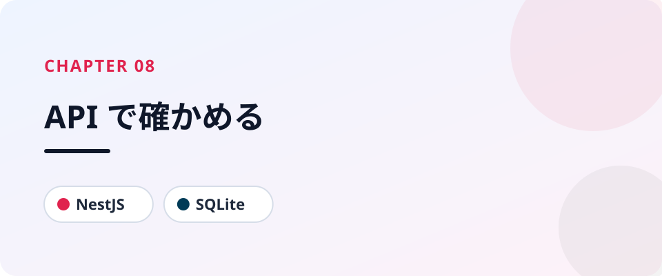
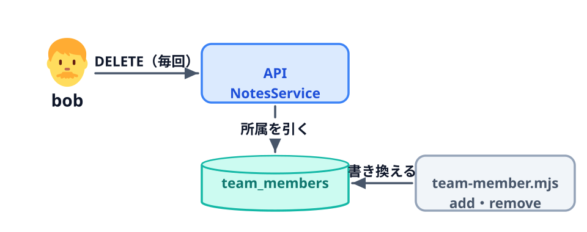

# API で確かめる



06 章で作った形を、比べる観点で見直します。コードは変えません（07 章の最後の形のままです）。



| 見るところ | この方法では |
|---|---|
| 所属を引く場所 | API の `NotesService` の `remove()`。`SELECT 1 FROM team_members WHERE teamId = ? AND userId = ?` |
| 引くとき | 消すリクエストのたびに 1 回 |
| 所属の決まりがある場所 | API と、API の SQLite |
| 所属を変えたとき | 次のリクエストからすぐ効く |

## 動作確認する

07 章の最後の状態で、alice のトークンで `team-a` のノートを作り、bob を `team-a` に入れて、bob のトークンで消せることを確かめます（`204`）。もう 1 つ `team-a` のノートを作り、bob を `team-a` から外します。

```bash
podman compose exec api node scripts/team-member.js remove bob@example.com team-a
```

さっきと **同じ bob のトークン** で消します。

```bash
curl -i -X DELETE http://localhost:3001/notes/<ノートの ID> -H 'Authorization: Bearer <bob のアクセストークン>'
```

1 行目が `HTTP/1.1 403 Forbidden` になれば大丈夫です。トークンを取り直さなくても、所属を外したことがすぐ効きます。

## 参考にした公式ドキュメント

この節は、次の公式ドキュメントをもとに書いています。

- [Node.js: SQLite](https://nodejs.org/docs/latest-v26.x/api/sqlite.html) … `statement.get()`
- [Docker: docker compose exec](https://docs.docker.com/reference/cli/docker/compose/exec/) … 動いているコンテナでコマンドを実行する
