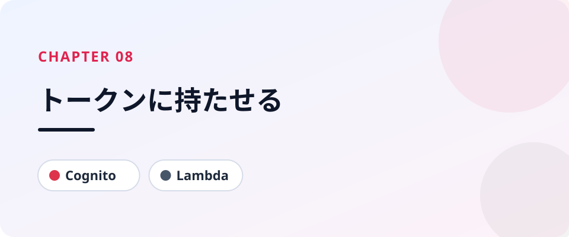
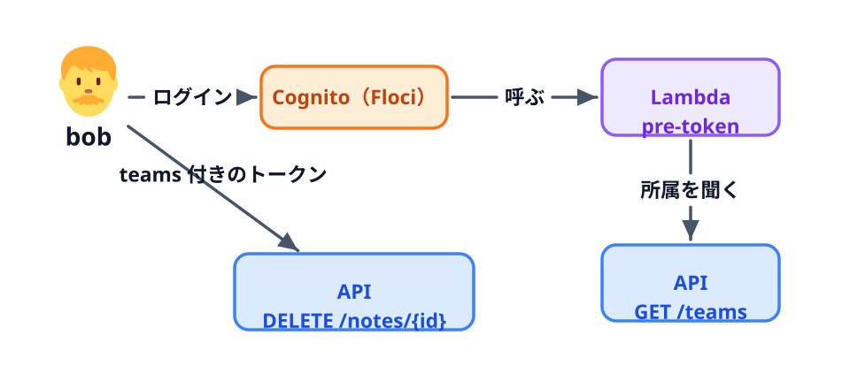

# トークンに持たせる



所属をアクセストークンに持たせます。ログインのとき、Cognito が **Pre Token Generation** の Lambda を呼び、Lambda が API に所属を聞いて、アクセストークンの `teams` クレームに載せます。API は消すときに `team_members` を引かず、トークンの `teams` だけを見ます。



## Floci で Lambda を動かせるようにする

Floci は、Lambda の関数をコンテナで動かします。そのために、Floci のコンテナに Podman のソケットを渡します。

::diff{file="api/compose.yaml"}

- `${PODMAN_SOCKET}:/var/run/docker.sock` … Podman のソケットの場所は、`.env` の `PODMAN_SOCKET` から読みます（このあと書きます）
- `label=disable` … SELinux のラベルのせいで、Floci がソケットに入れないのを防ぎます
- `FLOCI_SERVICES_LAMBDA_DOCKER_NETWORK: notes` … Lambda のコンテナを、このファイルのネットワーク（`notes`）につなぎます。Lambda から API にサービス名（`api`）で届きます
- `FLOCI_SERVICES_LAMBDA_DOCKER_HOST_OVERRIDE: floci` … Lambda のコンテナが、Floci にサービス名で返事をするようにします

Podman のソケットの場所を `.env` に書きます。

:::::platform
::::macos-linux
```bash
echo "PODMAN_SOCKET=$(podman info --format '{{.Host.RemoteSocket.Path}}' | sed 's|unix://||')" >> .env
```
::::
::::windows
```powershell
"PODMAN_SOCKET=$((podman info --format '{{.Host.RemoteSocket.Path}}') -replace 'unix://', '')" | Add-Content .env
```
::::
:::::

## Lambda の関数を書く

::diff{file="api/lambda/index.mjs"}

- `event.request.userAttributes.sub` … トークンを作る人の `sub` です
- `claimsAndScopeOverrideDetails.accessTokenGeneration.claimsToAddOrOverride` … アクセストークンに足すクレームです。V2 のトリガーの形です

## Lambda とトリガーを作る

セットアップのスクリプトで、Lambda の関数を作り、ユーザープールのトリガーにします。

::diff{file="api/scripts/setup-cognito.mjs"}

- `/2015-03-31/functions` … Lambda の関数を作る API です。中身は `lambda.zip` を base64 にして送ります
- `LambdaVersion: 'V2_0'` … V2 のトリガーにすると、アクセストークンにクレームを足せます
- `.env` は、`PODMAN_SOCKET` の行を残して書き直します

## 所属を返す入口を作る

Lambda が所属を聞く、API の入口を作ります。

```bash
npx nest g controller teams --no-spec
```

```text
CREATE src/teams/teams.controller.ts (99 bytes)
UPDATE src/app.module.ts (1044 bytes)
```

::diff{file="api/src/app.module.ts" by="command"}

::diff{file="api/src/teams/teams.controller.ts" base="generated"}

- `GET /teams?userId=<sub>` … その人が入っているチームの ID の配列を返します
- トークン無しで所属を返す入口なので、本番では外から届かない場所に置きます

## トークンの teams で確かめる

::diff{file="api/src/notes/notes.service.ts"}

- `user['teams']` … Lambda が足した `teams` クレームです。API は、ここでは `team_members` を引きません

## 動作確認する

ネットワークの名前を変えたので、いったん止めてから起動します。Lambda の関数を `lambda.zip` にしてから、セットアップのスクリプトを動かします。

:::::platform
::::macos
```bash
podman compose down
zip -j lambda.zip lambda/index.mjs
```
::::
::::linux
```bash
podman compose down
sudo apt-get install -y zip
zip -j lambda.zip lambda/index.mjs
```
::::
::::windows
```powershell
podman compose down
Compress-Archive -Path lambda/index.mjs -DestinationPath lambda.zip -Force
```
::::
:::::

```bash
podman compose up -d --build --wait
node scripts/setup-cognito.mjs
podman compose up -d --wait
```

alice と bob をサインアップし直し、bob を `team-a` に入れます。

```bash
podman compose exec api node scripts/team-member.mjs add bob@example.com team-a
```

bob でログインし直し、アクセストークンの中身を見ます。最初のログインは、Floci が Lambda を動かすイメージを取ってくるので、時間がかかります。

```bash
node -e "console.log(JSON.parse(Buffer.from(process.argv[1].split('.')[1], 'base64url')))" <bob のアクセストークン>
```

`teams: [ 'team-a' ]` が入っていれば大丈夫です。alice のトークンで `team-a` のノートを作り、bob のトークンで消すと `204` になります。

次に、もう 1 つ `team-a` のノートを作り、bob を `team-a` から外してから、**同じ bob のトークン** で消します。

```bash
podman compose exec api node scripts/team-member.mjs remove bob@example.com team-a
curl -i -X DELETE http://localhost:3001/notes/<ノートの ID> -H 'Authorization: Bearer <bob のアクセストークン>'
```

1 行目が `HTTP/1.1 204 No Content` になり、まだ消せてしまいます。トークンの `teams` は、作ったときの所属の写しだからです。もう 1 つ `team-a` のノートを作り、bob でログインし直したトークンで消すと、`HTTP/1.1 403 Forbidden` になります。

:::notice
本物の Cognito では、アクセストークンにクレームを足す V2 のトリガーは、ユーザープールの機能プランが Essentials か Plus のときに使えます。
:::

## 参考にした公式ドキュメント

この節は、次の公式ドキュメントをもとに書いています。

- [Amazon Cognito: Pre token generation Lambda trigger](https://docs.aws.amazon.com/cognito/latest/developerguide/user-pool-lambda-pre-token-generation.html) … V2 のイベントと `claimsAndScopeOverrideDetails`、機能プラン
- [Amazon Cognito API: CreateUserPool](https://docs.aws.amazon.com/cognito-user-identity-pools/latest/APIReference/API_CreateUserPool.html) … `LambdaConfig` の `PreTokenGenerationConfig`
- [AWS Lambda API: CreateFunction](https://docs.aws.amazon.com/lambda/latest/api/API_CreateFunction.html) … 関数を作る（`Runtime`・`Handler`・`Code.ZipFile`）
- [Floci: Lambda](https://floci.io/floci/services/lambda/) … Lambda をコンテナで動かすことと、`FLOCI_SERVICES_LAMBDA_DOCKER_NETWORK`・`FLOCI_SERVICES_LAMBDA_DOCKER_HOST_OVERRIDE`
- [Floci: Docker configuration（Running on Podman）](https://floci.io/floci/configuration/docker/) … Podman のソケットと `label=disable`
- [Podman: podman info](https://docs.podman.io/en/latest/markdown/podman-info.1.html) … `--format` で、ソケットの場所（`Host.RemoteSocket.Path`）を出す

## この節を終えたときのディレクトリ

::tree

:::download
[この節を終えた状態をダウンロード](./project.zip)
:::

:::faq

### ログインすると `PreTokenGeneration failed with error` と出る

Floci が Lambda のコンテナを起動できていません。`.env` に `PODMAN_SOCKET` の行があるか、`compose.yaml` の `label=disable` があるかを確かめ、`podman compose down` から「動作確認する」をやり直してください。

:::
