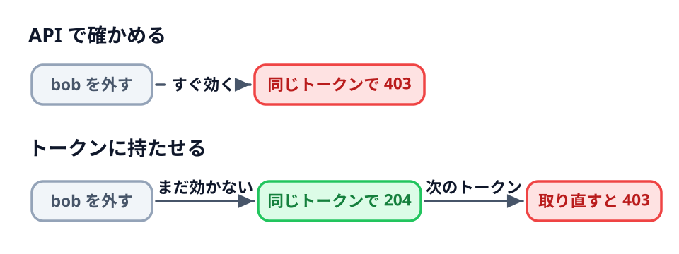
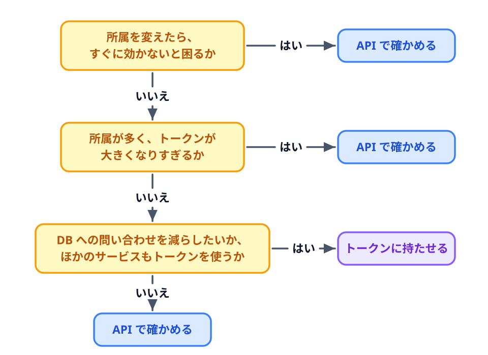

# 比べる

「API で確かめる」と「トークンに持たせる」の 2 つの方法を比べ、どちらを選ぶかの目安を決めます。コードは書きません。

| 観点 | API で確かめる | トークンに持たせる |
|---|---|---|
| 所属を変えたときにいつ効くか | 次のリクエストからすぐ | 次のトークンから（ログインし直すか、トークンを更新したあと） |
| リクエストごとの DB への問い合わせ | 毎回 1 回 | 無い（ログインのときに 1 回） |
| トークンの大きさ | 変わらない | 所属の数だけ大きくなる。トークンはリクエストのたびに送る |
| 所属の決まりがある場所 | API | 認証基盤（Lambda）と API の両方 |
| 認証基盤への依存 | トークンの検証だけ | Pre Token Generation のトリガーが要る（本物の Cognito では機能プランも） |
| 取り消しやすさ | 所属を外せば、すぐ取り消せる | 配ったトークンの期限が切れるまで残る |

## 選び方

上から順に問いをたどって決めます。

1. **所属を変えたら、すぐに効かないと困るか** … チームから外した人に、すぐ消せなくなってほしいなら、API で確かめます。トークンに持たせると、トークンの期限（このハンズオンでは 1 時間）まで残ります
2. **所属が多く、トークンが大きくなりすぎるか** … 1 人が多くのチームに入る場合は、トークンがリクエストのたびに重くなるので、API で確かめます
3. **DB への問い合わせを減らしたいか、ほかのサービスもトークンを使うか** … リクエストが多くて DB を引く回数を減らしたいときや、API のほかにも同じトークンで所属を知りたいサービスがあるときは、トークンに持たせます。どれでもなければ、決まりが API にまとまっている「API で確かめる」が素直です

## 参考にした公式ドキュメント

この節は、次の公式ドキュメントをもとに書いています。

- [Amazon Cognito: Pre token generation Lambda trigger](https://docs.aws.amazon.com/cognito/latest/developerguide/user-pool-lambda-pre-token-generation.html) … トークンに足すクレームと、機能プラン
- [Amazon Cognito: Understanding user pool JSON web tokens (JWTs)](https://docs.aws.amazon.com/cognito/latest/developerguide/amazon-cognito-user-pools-using-tokens-with-identity-providers.html) … アクセストークンの有効期限
